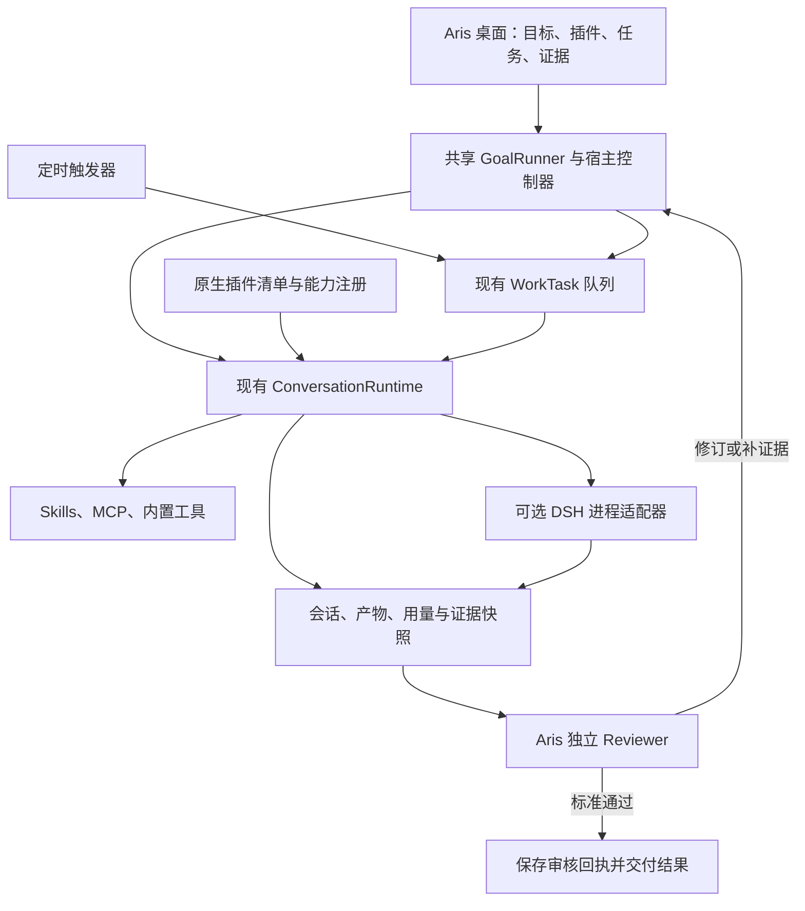

# deepseek-harness 插件系统与 Aris 融合调研

日期：2026-11-04。结论：**可以融合，优先把它的插件组织和工作台扩展机制移植到 Aris；保留 Aris 的 Rust 执行内核与独立 Reviewer。需要运行原生 DSH 插件时，再增加可选的独立进程适配器。**

本报告中的“自动工作台”涵盖目标续跑、定时触发、工作流编排、后台作业和可扩展界面，并不假定这些能力属于一个单独模块。本轮交付为源码调研和实施建议，未安装运行 DSH、调用模型或实现集成。

## 调研基线

| 项目 | 固定依据 |
| --- | --- |
| DSH | `deepseek-ai/deepseek-harness@fcc0ad462172522aaf5c93a7b2e01f6b9f0b0159`，2026-11-04，包版本 `0.2.2-rc.1` |
| 产品阶段 | README 明确为 developer preview，预计会出现破坏兼容性的变更 |
| 技术栈 | Node.js `>=24.9.0`、TypeScript、Cordis；Web 界面及 Electron 桌面载体 |
| 许可证 | 根项目为 MIT；实际复制或分发代码时仍须按涉及的包保留许可并核对第三方 notices |
| Aris | HEAD `99243d44f2a8625e124067dc42ced319acfbb721`，同时读取当前工作目录中的实际源码；没有把未提交修改视为已发布功能 |
| 证据存档 | `.somniq/research/deepseek-harness-2026-11-04/` 保存上游研究副本、源码 SHA-256 清单、报告创建前的工作区状态和原项目目标备份 |

基线见 [DSH README][D0]、[package.json][D1]、[架构说明][D2]。下文区分上游现有行为、Aris 现有实现和本报告建议。

## 1. 插件系统的实质

DSH 的插件是运行时模块，可以提供模型适配、工具、会话、Agent 循环、后台服务或界面。Skill 和 MCP 是其中两种能力来源，不能代表整个插件系统。

| 机制 | 上游实际做法 | 对 Aris 的价值 |
| --- | --- | --- |
| 服务注册与依赖 | 插件通过 `apply(ctx)` 或 Service 类装载；`inject` 声明依赖，消费者从 `ctx.tools`、`ctx.sessions` 等稳定接口取能力 | 把能力接口、实现和模型工具分开，减少新增功能时对大文件的修改 |
| 事件扩展 | `agent/*`、`tools/*` 等带类型事件支持观察、中间件和生命周期接入 | 为进度、审计、预算等建立明确扩展点；关键权限和审核判定仍由宿主控制 |
| 生命周期清理 | `ctx.effect()`、监听器和注册项有 disposer，卸载时撤销贡献并处理关联资源 | 插件关闭后，工具、计时器、监听器和界面能够一致退出 |
| 配置组合 | 按顺序应用 bundles → profile patch → home patch → 启动 overlay；按行 ID 修改插件树 | 提供内置能力包和用户覆盖；记录最终配置及来源，便于解释和恢复 |
| 安装和激活分离 | `plugin_manager` 管理依赖、启用状态及实际加载结果；HMR 关闭时明确返回 `restart-required` | 界面应区分可获取、已安装、已启用、运行中、失败、需重启 |
| 管理操作可追踪 | profile 文件锁、原子写入、兼容性检查、安装诊断和操作事件 | 插件配置变化应当有可检查的记录，而不只是开关状态 |
| 前后端插件 | 包可声明 `dsh.client`，客户端再通过 Slots、Remote 和服务注入进入布局 | 借鉴扩展位置与数据合同，支持科研结果面板、工具卡片和侧栏 |

源码核对：`app-boot/src/profile.ts` 的 `composeEntries()` 确实把分层 patch 应用于空配置；`plugin-manager/src/patch.ts` 的 `writePluginEnabled()` 保存覆盖项；安装和文件恢复分别位于 `plugin-manager/src/index.ts`、`operations.ts`。框架和管理合同见 [Cordis primer][D3]、[Plugin Manager][D4]。

需要保留两个边界：

- **插件安装不是工作区内的普通文件编辑。** 上游明确说明，已安装 Host 插件在进程内运行，处于 workspace sandbox 之外。安装失败对 manifest/lockfile 的恢复，也不等于撤销已经运行的依赖脚本等全部副作用。Aris 的第三方可执行扩展宜从独立进程开始。
- **配置隔离不是系统安全隔离。** Cordis 的 scope/realm 用于服务可见性和生命周期，不能代替进程隔离及 Aris 的权限检查。

### “AI 自己扩展工作台”目前能做到什么

Creator 模式提供 `cordis_inspect_list/query`，让模型读取 Host/Client 服务、工具、配置 schema，再编写插件包，通过 Plugin Manager 安装。HMR 启用且加载成功时，能力可以在运行中的 profile 生效。这条路径能作为 Aris 后续“按科研任务生成工具和面板”的参考。[Creator 流程][D5]

另有 `cordis-host-runner` / `cordis-client-runner` 的动态定义机制，但当前定义只在进程内保存，重启即消失；页面刷新也不自动恢复 Client 半部。其文档明确说**没有模型工具创建动态定义**，当前 Creator 的持久路径是安装插件包。不能将两者混同为任意生成的 UI 已经能够持久自动恢复。[Host runner][D6]

Slots 提供 `single/list/keyed/chain/hoc` 等扩展位置，并将注册与清理绑定。Aris 可先实现少量明确位置，不必引入整套 Cordis UI 类型系统，也不需要立即支持模型提交任意 React/JavaScript。[Slots][D7]

插件市场本身只是可配置的 JSON 索引；“发现”属实验性能力，且不内置索引源。可借鉴包来源、精确版本和兼容性展示，但目前不能把它当作已有稳定生态规模的证据。[插件索引][D8]

## 2. 自动执行有哪些真实能力

| 部分 | 已有能力 | 集成时必须知道的限制 |
| --- | --- | --- |
| Goal | 同一会话持续追求一个目标；目标事件持久化；`id/revision` 做比较更新；轮次上限默认 256 | **没有独立 evaluator**；完成仍由目标工具和执行模型判断；轮次上限也不等于 token、费用或时间预算 |
| Goal round driver | 空闲时续跑；先 flush，再检查版本和竞争输入；仅实际接纳的轮次计数；人工输入可以优先 | 恢复或 fork 后不会因为读到 active 就自行启动；执行资格 `armed/disarmed` 为进程内状态 |
| Ralph | 对固定目标逐轮启动新子 Agent；只传递有界交接报告，工作区承载长期进展 | 实验性且默认关闭；前台调用；完成或阻塞报告没有独立验证，不能替代 Aris Reviewer |
| Workflow/PTC | JavaScript 组合 `agent/parallel/pipeline/phase/log`；有并发和子任务数量限制、取消和资源清理 | 没有脚本检查点与重启续跑，也没有跨子任务 token 预算合同；普通子任务失败可能返回 `null`，编排方须处理 |
| Workflow 后台模式 | 当前 `tool-workflow` 支持 `run_in_background`，返回 `jobId/runId` 并观察进度 | 默认 Jobs 的执行和输出环是进程内状态；持久化开始/结束事件不等于能够重启恢复执行 |
| Schedule | 一次性、周期、Cron、带时区 RRULE；现有会话、首次新建后复用、每次新会话三种目标；保存发送历史 | 宿主必须在线；错过多次合并为最新一次；投递为 at-least-once；记录证明收件箱持久化，不证明模型完成任务 |
| Web/Desktop 工作台 | 会话、插件、自动化任务、作业及扩展面板相互连接 | 界面依赖 DSH 的 Slots、Remote、会话投影和插件装载链；不能作为普通 React 组件直接嵌入后就获得运行能力 |

依据：[Goal service][D9]、[Goal driver][D10]、[Ralph][D11]、[Workflow][D12]、[后台 Workflow 工具][D13]、[Jobs][D14]、[Schedule][D15]。

源码交叉检查包括：

- `goal-round-driver/src/index.ts` 的 `drive()` 确实先 `sessions.flush()`，再核对目标并排入带身份的轮次；`agent/pre-step` 在下游中间件前后核查轮次。
- `tool-goal/src/authority.ts` 验证根 Agent、人工输入或当前目标轮次的操作权限。这些是调用权限检查，没有独立质量审查者。
- `tool-workflow/src/index.ts` 确实包含后台 Job 注册和结果处置；`workflow` 服务 README 中“前台收集”的描述不能覆盖工具层已经增加的后台模式。
- `schedule/src/runtime.ts` 在会话收件箱 flush 后保存投递回执；会话与调度记录是两个提交，不能据此承诺端到端恰好执行一次。

因此，DSH 很适合参考“可组合的 Agent 工作空间”，但其默认自动循环并没有覆盖 Aris 所需的独立证据审核和持久科研任务全部要求。

## 3. Aris 已有基础与需要补的部分

以下结论来自当前源码，而不是仅根据历史设计文档判断完成度。

| 能力 | Aris 当前实现 | 建议 |
| --- | --- | --- |
| Skills | `crates/tools/src/lib.rs` 的 `discover_skills()`、搜索根和解析；`runtime/skill_registry.rs` 管理规范名与别名 | 纳入统一插件清单，沿用现有调用链 |
| MCP | `runtime/mcp_stdio.rs`、`chat/lib.rs`、Desktop `mcp.rs` 已有发现、调用和管理 | 首版插件工具复用 STDIO；配置识别 HTTP/SSE 不代表已经能执行远程传输 |
| Hooks | `runtime/hooks.rs` 目前主要为 `PreToolUse/PostToolUse` 命令 | 逐步增加类型明确的宿主扩展合同；不能直接加载任意 Cordis 中间件 |
| 项目目标 | `runtime/project_goal.rs` 保存目标、标准及验证记录 | 项目目标与 DSH 每 Session 一个 Goal 的作用域不同，不能逐字段覆盖 |
| 独立审核 | Desktop `engine.rs::review_participants()` 检查模型身份；`review_thread.rs` 使用隔离会话及只读工具 | 保留为宿主拥有的能力；插件不能声明自己已审核或替换最终 verdict |
| 后台任务 | `work_task/` 有队列、工作树、暂停、等待输入、中断恢复及 `review_and_revise()` | 继续作为真实任务执行路径，扩展其能力入口 |
| 定时任务 | `scheduled.rs::dispatch()` 已调用 `queue_scheduled_run()` 后进入 WorkTask 引擎 | 已经接通任务与审核链路；补时区、日历规则、投递回执、历史及幂等策略 |
| 专业科研流程 | `runtime/review_workflow_driver.rs::next_step()` 明确区分 Executor/Reviewer 动作 | 保留领域流程，用适配器与通用运行控制器衔接 |
| 目标模式完整闭环 | 现有 `goal-mode-openhands-build-plan.md` 给出了共享 GoalRunner、事务、预算和恢复方案；本次未发现其建议的 `goal_run/` 和 `goal_runner.rs` 已落地 | 在原计划上吸收 DSH 的轮次准入和生命周期机制，避免再建立另一套目标引擎 |
| 桌面控制面 | 已有 ProjectBrief、Tasks、ScheduledTasks、Workflows 等入口 | 用统一运行快照串起目标、任务、审核、证据与结果，保留现有专业页面 |

特别是：Aris 定时任务目前按分钟/小时/天间隔解释 RRULE，不能因为字段名叫 `rrule` 就声称已有完整日历调度。DSH 的时区与规则表达在这方面更完整；Aris 已有的 WorkTask → 独立审核链路则应继续使用。

本地依据：[Skills](../../crates/tools/src/lib.rs)、[Hooks](../../crates/runtime/src/hooks.rs)、[MCP](../../crates/runtime/src/mcp_stdio.rs)、[项目目标](../../crates/runtime/src/project_goal.rs)、[定时调度](../../desktop/src-tauri/src/scheduled.rs)、[后台任务](../../desktop/src-tauri/src/work_task/engine.rs)、[独立 Reviewer](../../desktop/src-tauri/src/review_thread.rs)、[已有目标模式计划](goal-mode-openhands-build-plan.md)。

## 4. 三条融合路线

| 路线 | 能获得什么 | 代价与适用性 |
| --- | --- | --- |
| **原生移植设计，推荐主线** | 统一插件包、能力注册、明确生命周期、可组合工作台；继续复用 Rust/Chat/Tools | 需要实现 Aris 的数据合同；最符合本地科研连续性和独立审核原则 |
| **DSH 独立进程适配器，可选** | 通过官方 ACP 在 DSH 的 Node/Cordis 环境执行任务，复用其插件，把有界结果交给 Aris | 多一套运行时与会话，需要版本固定、权限、证据和用量映射；适合确有独特价值的插件 |
| **整套 DSH Web 界面嵌入** | 可以较快展示 DSH 完整体验 | 会形成两套会话、配置、权限和完成语义；不宜作为 Aris 的核心集成，只适合对比演示 |

“直接兼容 DSH 插件”和“借鉴其插件系统”应分别验收。Skills 文本、普通 MCP 服务和部分纯逻辑代码可以适配；依赖 `ctx`、事件、Remote、Slots 的 DSH 插件，需要运行环境或移植，不能靠改一个 manifest 就原生兼容。

### 推荐的运行关系

图中的 GoalRunner 与统一插件注册属于建议新增；WorkTask、ConversationRuntime、Skills/MCP 和 Reviewer 有现有实现可复用。目标循环对其拥有的运行应只有一个审核调度方，避免 GoalRunner 与 WorkTask 同时重复发起审查。最终合并、发布或对外发送继续走现有授权入口。

### 原生插件包的最小合同

建议第一版插件包是声明式能力集合，不开放第三方 Rust 动态库：

| 字段组 | 最小内容 |
| --- | --- |
| 身份 | `id`、`version`、Aris API 兼容范围、来源与内容摘要 |
| 能力 | Skills 目录、MCP STDIO 服务声明；后续才增加工作流模板与面板 |
| 权限 | 所需能力与作用域，由宿主核对现有权限策略；声明本身不授予权限 |
| 依赖 | 精确依赖版本及锁定信息；缺失或冲突给出可诊断状态 |
| 状态 | 安装、启用、实际激活、失败、待重启分别保存和展示 |
| 生命周期 | 初始化、停用、运行排空、资源清理，以及版本切换的记录 |

安装缓存可以在应用配置目录共享，项目单独保存启用选择与授权引用；对 MCP 的写入仍沿用 Desktop 当前的全局管理规则，不自动提升项目里的 MCP 配置。运行开始时冻结插件版本和权限快照，版本升级不应悄悄改变在途实验或审查的能力。

工具最终仍进入现有 Kernel/权限检查及动态工具路由。Reviewer 的只读白名单、身份检查和完成权限不属于第三方可覆盖的扩展点。早期界面优先支持声明式结果卡、表格、证据列表等；可执行 UI 扩展放在明确的宿主桥接合同之后。

### 如果需要运行 DSH 原生插件

**外部执行器优先选官方 ACP，而不是先扩充 DSH SDK。** `dsh --profile acp` 使用标准 Agent Client Protocol v1，通过 STDIO 的 JSON-RPC 提供：

- `session/new/list/resume/close`：创建、列出、恢复和独立关闭会话。
- `session/prompt`：等待本次活动、受管理子任务和更新发送结束，再返回停止原因。
- `session/cancel` / `$/cancel_request`：取消在途活动。
- `session/update`：提交后的消息、通用工具生命周期、配置和上下文用量。
- `session/request_permission`：一次性允许或拒绝，由 Aris 客户端接管决策。

本次已检查 `acp/src/index.ts` 的请求注册和 `acp/src/session.ts` 的 prompt、cancel、close 路径，不仅依赖 README。这个协议适合把 DSH 接成有界任务执行器，也使未来增加其他 ACP 兼容执行器有统一入口。[ACP 合同][D18]、[ACP 应用 profile][D19]

ACP 不携带 DSH 专有卡片、计划、终端 UI 或历史回放，也不提供任意插件的远程函数调用。它和 MCP 是不同协议，不能直接填进 Aris 当前 MCP 配置。第一版目标应是**有界任务执行后返回产物与证据**，不承诺代理所有 DSH 工具和 UI。

适配器仍须处理四项工作：

1. 冻结 DSH 包版本、插件和专用 profile；使用隔离 `DSH_HOME`，实现超时后的进程树清理。ACP 本身已有会话取消/关闭，不必为基本取消先修改上游。
2. 映射 prompt 的活动结束与停止原因，同时把实际产物纳入 Aris 快照；会话恢复不会重放历史，完整审计不能只依赖重新连接后的更新流。
3. 将 permission 请求交给 Aris 策略；客户端绝对路径、MCP 命令及环境在 ACP 中属于可信控制输入，协议也不自动提供 OS 隔离。需限定能力和凭据，并实测子进程约束；不能从某个 DSH profile 的默认模式推断权限等价。
4. DSH 的停止原因和结束报告只算执行结果；产物进入 Aris 后，仍由 Aris Reviewer 读取证据。上下文用量更新不必然等于完整计费账本，子任务用量无法归集时应标记缺失，不能记为零。

上游另外提供 `dsh --profile sdk` 和原始 Session 事件，可在确需 DSH 专有事件时评估。[SDK wire][D16] 但当前 SDK wire 没有按会话 cancel/close，`session/prompt` 的 `messageId` 只是入队回执；其自动补装模型适配器的 fallback 也仅针对 DeepSeek。使用 SDK 时需要额外生命周期策略及明确 adapter 配置，不应把这些限制误认为 ACP 的限制。[SDK server][D17]

## 5. 建议的实施顺序与验收

优先顺序为统一能力入口 → 自动运行内核 → 工作台投影；DSH 原生兼容作为有明确插件需求后再启动的支线。下面是范围划分，不是已经完成的功能或工期承诺。

| 阶段 | 建议落点 | 可观察验收条件 |
| --- | --- | --- |
| 1. 插件包最小版 | 建议新增 `runtime/plugin/`；连接 `tools` Skills、`chat` MCP；Desktop 插件页 | 能从本地包启停一个文献 Skill + MCP 组合；展示来源/版本/实际生效状态；禁用后下一次执行不再暴露其工具；失败不伪装成功 |
| 2. 自动执行闭环 | 按已有 OpenHands 计划的状态存储、Reviewer 合同、共享 Runner、恢复顺序实施；吸收 DSH 准入与 flush 机制 | 跨至少两轮执行/审核推进；Reviewer 能拒绝无证据完成；预算、人工输入、暂停和取消有效；迟到结果不能复活旧运行 |
| 3. 工作台与调度 | Rust 运行快照；连接现有 ProjectBrief/Tasks/ScheduledTasks/Workflows；扩充 Schedule 合同 | 一处能看到当前目标、动作、审核、证据、费用和停止原因；切页面持续执行；重启显示真实恢复状态；定时投递与任务执行历史分开 |
| 4. 面板扩展与检查工具 | 建议新增小型 `ExtensionSlotRegistry` 和只读能力查询；先开放结果卡、侧栏、证据面板 | 一个第三方面板能安装、卸载、显示真实数据并隔离渲染失败；没有任意 Tauri 命令调用权；停用清理订阅与界面贡献 |
| 可选支线. DSH bridge | 建议新增 `chat` 的 ACP 客户端适配器及受控 Node 子进程宿主 | 固定版本和 profile 执行一个有界任务；记录更新/产物/用量；验证按会话取消、关闭、恢复及进程清理；DSH 自报完成后仍进入 Aris 独立审核 |

与阶段 2 相关的现有目标模式计划继续有效，本报告不另设一套 JSON 目标事实源。插件包、UI 扩展和执行控制器也应分层，避免一次性给所有现有内置模块套插件壳。

适合第一个原型的科研场景：安装一个“文献检索与证据整理”能力包，给出有界主题和材料范围，生成带出处的证据表；Reviewer 独立读源材料，拒绝无法核实的结论，执行器自动补齐后交付。这个场景同时验证插件入口、跨轮推进、证据链和审核分工。

工程验收应覆盖安装失败/不兼容/停用、重复定时投递、人工插入消息、执行后崩溃且副作用未知、审核不可用、证据版本改变及预算耗尽。实施后按仓库规则运行 focused Rust/Vitest、涉及跨 crate 时的 workspace tests，以及 Desktop 类型检查与生产构建；实际 Windows 重启与取消验收另行记录。本次调研没有运行这些产品实现测试。

## 参考源码

上游链接均固定到本次检查的提交；Aris 本地源码哈希见研究目录的 `evidence-manifest.json`。

[D0]: https://github.com/deepseek-ai/deepseek-harness/blob/fcc0ad462172522aaf5c93a7b2e01f6b9f0b0159/README.md
[D1]: https://github.com/deepseek-ai/deepseek-harness/blob/fcc0ad462172522aaf5c93a7b2e01f6b9f0b0159/package.json
[D2]: https://github.com/deepseek-ai/deepseek-harness/blob/fcc0ad462172522aaf5c93a7b2e01f6b9f0b0159/docs/architecture.md
[D3]: https://github.com/deepseek-ai/deepseek-harness/blob/fcc0ad462172522aaf5c93a7b2e01f6b9f0b0159/docs/cordis-primer.md
[D4]: https://github.com/deepseek-ai/deepseek-harness/blob/fcc0ad462172522aaf5c93a7b2e01f6b9f0b0159/packages/boot/plugin-manager/README.md
[D5]: https://github.com/deepseek-ai/deepseek-harness/blob/fcc0ad462172522aaf5c93a7b2e01f6b9f0b0159/docs/user/develop/practice/dynamic-cordis.md
[D6]: https://github.com/deepseek-ai/deepseek-harness/blob/fcc0ad462172522aaf5c93a7b2e01f6b9f0b0159/packages/extensions/cordis-host-runner/README.md
[D7]: https://github.com/deepseek-ai/deepseek-harness/blob/fcc0ad462172522aaf5c93a7b2e01f6b9f0b0159/packages/client/ui-slots/README.md
[D8]: https://github.com/deepseek-ai/deepseek-harness/blob/fcc0ad462172522aaf5c93a7b2e01f6b9f0b0159/docs/user/guide/plugin-market.md
[D9]: https://github.com/deepseek-ai/deepseek-harness/blob/fcc0ad462172522aaf5c93a7b2e01f6b9f0b0159/packages/goal/goal/README.md
[D10]: https://github.com/deepseek-ai/deepseek-harness/blob/fcc0ad462172522aaf5c93a7b2e01f6b9f0b0159/packages/goal/goal-round-driver/README.md
[D11]: https://github.com/deepseek-ai/deepseek-harness/blob/fcc0ad462172522aaf5c93a7b2e01f6b9f0b0159/packages/experimental/tool-ralph/README.md
[D12]: https://github.com/deepseek-ai/deepseek-harness/blob/fcc0ad462172522aaf5c93a7b2e01f6b9f0b0159/packages/workflow/workflow/README.md
[D13]: https://github.com/deepseek-ai/deepseek-harness/blob/fcc0ad462172522aaf5c93a7b2e01f6b9f0b0159/packages/workflow/tool-workflow/README.md
[D14]: https://github.com/deepseek-ai/deepseek-harness/blob/fcc0ad462172522aaf5c93a7b2e01f6b9f0b0159/packages/jobs/jobs-local/README.md
[D15]: https://github.com/deepseek-ai/deepseek-harness/blob/fcc0ad462172522aaf5c93a7b2e01f6b9f0b0159/packages/schedule/schedule/README.md
[D16]: https://github.com/deepseek-ai/deepseek-harness/blob/fcc0ad462172522aaf5c93a7b2e01f6b9f0b0159/packages/sdk/protocol/src/types.ts
[D17]: https://github.com/deepseek-ai/deepseek-harness/blob/fcc0ad462172522aaf5c93a7b2e01f6b9f0b0159/packages/sdk/server/README.md
[D18]: https://github.com/deepseek-ai/deepseek-harness/blob/fcc0ad462172522aaf5c93a7b2e01f6b9f0b0159/packages/acp/acp/README.md
[D19]: https://github.com/deepseek-ai/deepseek-harness/blob/fcc0ad462172522aaf5c93a7b2e01f6b9f0b0159/packages/bundle/acp-app/README.md
