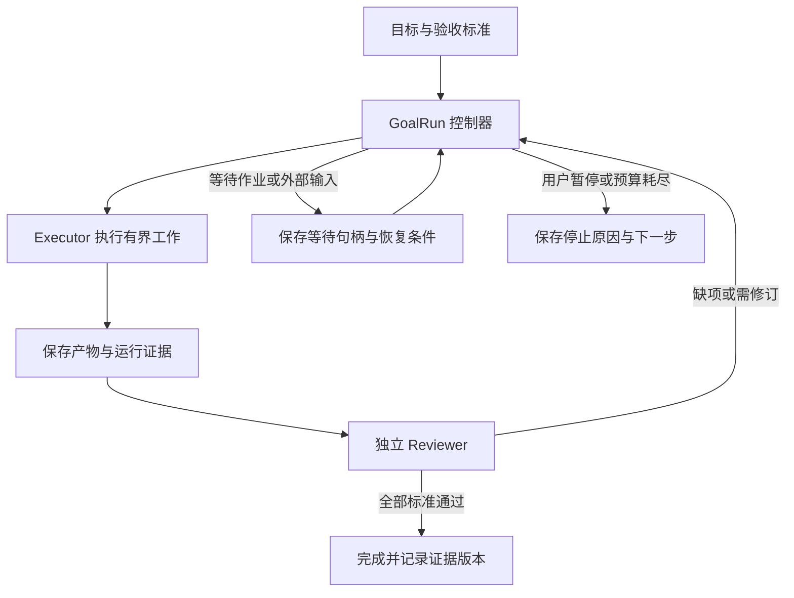

# GitHub Agent 目标模式实现调研

调研批次：`goal-mode-2026-10-23`。本项目代码基线：`99243d44f2a8625e124067dc42ced319acfbb721`。

## 结论

目标模式需要同时解决三件事：保存目标及完成条件；在一次执行结束后决定是否继续；依据证据判定完成。提示词负责告诉模型怎样工作，运行时负责真的启动下一轮、限制预算和处理异常，验收层负责决定结果是否可信。

对 SomniQ 最有价值的组合是：借鉴 Codex 的 Rust 目标运行时和用量记账，借鉴 OpenHands 的 Executor → judge → followup 外层控制器，借鉴 LoopX 的验收版本和证据有效期，并保留本项目现有的独立 Reviewer。LangGraph 可作为检查点与恢复语义的参考；不需要为了这些机制引入另一套 Python 运行时。

## 检索范围与证据

GitHub 仓库检索使用了 `agent "goal mode"` 和 `"goal mode" in:readme agent`，分别返回 39 和 1,583 条匹配。匹配数量不代表已经逐个评估。另定向检查 Codex、Kimi、OpenHands、Ralph、LangGraph，最终阅读下列 9 个仓库的相关代码，归纳为 8 类方案。

所有代码链接固定到调研时读取的提交。源码快照、GitHub 检索结果、下载时间和 SHA-256 保存在项目本地 `.somniq/research/goal-mode-2026-10-23/`；这是静态源码分析，没有安装或运行这些上游 Agent，也没有进行效果、费用或稳定性基准测试。

| 仓库 | 固定提交 | 本次主要核对内容 |
| --- | --- | --- |
| [openai/codex](https://github.com/openai/codex/tree/970111f6cb62cc02fe36a82ea7d71b37a2889c97/codex-rs/ext/goal) | `970111f6cb62` | goal 扩展、空闲续跑、状态库、用量归属与错误停止 |
| [MoonshotAI/kimi-code](https://github.com/MoonshotAI/kimi-code/tree/7ccac2b45b8a3481c76f771bb99c043b562de2c5/packages/agent-core-v2/src/features/goal) | `7ccac2b45b8a` | v2 goal actor、持久事件、turn 生命周期与硬预算 |
| [OpenHands/software-agent-sdk](https://github.com/OpenHands/software-agent-sdk/tree/acd96e6fa424c02432304395b9208f99be24b54d/openhands-sdk/openhands/sdk/conversation/goal) | `acd96e6fa424` | GoalController、独立 judge 调用、同步 runner |
| [OpenHands/OpenHands](https://github.com/OpenHands/OpenHands/tree/11eba891cb2455f87253888d9d3bf3f6b0f12bc1) | `11eba891cb24` | Agent Canvas 的 `/goal` 入口与状态事件投影 |
| [prevalentWare/opencode-goal-plugin](https://github.com/prevalentWare/opencode-goal-plugin/tree/681e11ed115df13bd8a8e2bac5635d5b4e0b87f3) | `681e11ed115d` | V1/V2 插件事件、目标计划、续跑预留与取消竞态 |
| [snarktank/ralph](https://github.com/snarktank/ralph/tree/6c53cb0b831ebe8739c6a003e22af14902d8b0b5) | `6c53cb0b831e` | Shell 外循环、PRD 任务状态与磁盘交接 |
| [lokafinnsw/claude-code-goal-mode](https://github.com/lokafinnsw/claude-code-goal-mode/tree/338fa657ef055164c139a371d0c15ae7d0977281) | `338fa657ef05` | Stop hook、任务树、逐项证据、review gate 与三维预算 |
| [langchain-ai/langgraph](https://github.com/langchain-ai/langgraph/tree/4c52e129eb1ab69a3da58b799f67929f77d81149) | `4c52e129eb1a` | 条件图、checkpoint、interrupt/resume 与持久性模式 |
| [loopx-project/loopx](https://github.com/loopx-project/loopx/tree/19ccb632845ceae49ca6463ef26e868e2dcc1a45) | `19ccb632845c` | 验收契约、目标实例身份、证据版本与任务租约 |

本地已有 Kimi 克隆的提交是 `ac1882fe28c9`，与线上结构不同；最终结论以表中的线上 v2 源码为准。本次一个旧文档路径返回 404，未用它证明当前版本行为，失败记录保留在来源清单中。

## 八类方案的具体实现

### 1. Codex：运行时原生目标扩展

目标与 thread 绑定。`ThreadGoal` 保存 `goal_id`、objective、status、token_budget、tokens_used、time_used_seconds 和时间戳；`GoalStore` 使用 SQLite。状态包括 `active`、`paused`、`blocked`、`usage_limited`、`budget_limited`、`complete`，把任务成功和资源停止分开表达。

`GoalRuntimeHandle::continue_if_idle()` 在续跑前拿目标修改许可，重新读取持久目标、检查 deferral 和 active 状态，再通过宿主 `start_turn_if_idle()` 启动带 goal trigger 的下一轮。这比“模型回复结束后立刻再发一句继续”多了并发仲裁：修改目标、人工输入和自动续跑不能仅凭之前读到的状态各自启动。

goal 扩展监听 turn start/stop/abort/error、token usage 和工具完成事件。记账代码区分 turn 与 goal，包含后代 Agent 的用量归属；存储层有 `expected_goal_id`，避免迟到事件写进替换后的目标。连续执行失败和空响应有运行时保护；不可重试或重试耗尽的 turn 错误会阻止目标无限续跑。

完成由 `update_goal` 的状态变更触发，continuation 模板要求逐项完成审计及阻塞审计。本次检查的 goal 扩展没有逐条验收证据与独立 Reviewer 结果绑定的强制完成门禁；不应把提示词中的“必须验证”当成已经实现的独立验收系统。

来源：[runtime.rs](https://github.com/openai/codex/blob/970111f6cb62cc02fe36a82ea7d71b37a2889c97/codex-rs/ext/goal/src/runtime.rs)、[accounting.rs](https://github.com/openai/codex/blob/970111f6cb62cc02fe36a82ea7d71b37a2889c97/codex-rs/ext/goal/src/accounting.rs)、[extension.rs](https://github.com/openai/codex/blob/970111f6cb62cc02fe36a82ea7d71b37a2889c97/codex-rs/ext/goal/src/extension.rs)、[continuation 模板](https://github.com/openai/codex/blob/970111f6cb62cc02fe36a82ea7d71b37a2889c97/codex-rs/ext/goal/templates/goals/continuation.md)。

### 2. Kimi Code：事件持久化与 turn 生命周期驱动

v2 `GoalState` 包含 goalId、objective、可选 completionCriterion、status、turnsUsed、tokensUsed、wallClockMs 和 budgetLimits。`GoalCreate`、`GoalUpdate`、`GoalClear` 被声明为 durable 事件，服务将持久状态与 pendingContinuation 等临时效果状态分开。

`handleTurnEnded()` 在正常结束后检查目标身份、active 状态和预算，再调用 `launchContinuationTurn()`；续跑消息带 `system_trigger/goal_continuation` 来源。达到单轮 step 上限可以换一轮继续，普通失败则分类处理。`pendingContinuation` 防止重复提交，goalId/turn 关联避免旧工具调用影响新目标。

预算支持 token、turn、wall-clock 三个维度。耗尽后目标被标记为 blocked，并通过工具执行策略拒绝后续工具，允许有限的收尾行为。重放恢复时，原 active 目标会转为 paused；用户中断与运行时错误也有明确暂停路径。完成状态发出统计事件后清除当前目标，历史通过 durable 事件保留。

完成仍由模型调用 `UpdateGoal` 触发；这里的 completion audit 主要通过工具说明和 continuation 提示约束。本次检查的 goal 模块未提供 SomniQ 式逐项独立 Reviewer 门禁。三次阻塞审计属于模型指令，不能据此宣称运行时已经验证了同一语义阻塞连续发生三次。

来源：[goalOps.ts](https://github.com/MoonshotAI/kimi-code/blob/7ccac2b45b8a3481c76f771bb99c043b562de2c5/packages/agent-core-v2/src/features/goal/goalOps.ts)、[goalService.ts](https://github.com/MoonshotAI/kimi-code/blob/7ccac2b45b8a3481c76f771bb99c043b562de2c5/packages/agent-core-v2/src/features/goal/goalService.ts)。

### 3. OpenHands：每轮执行后单独调用 judge

`run_goal()` 在外层驱动已有 conversation：发送 objective → `conversation.run()` → `GoalController.on_run_finished(events)`。控制器调用 `judge_goal()`，得到 `score`、`complete`、`missing`；通过则返回 `GoalDone`，否则将缺项写成 followup，交回同一个 conversation 继续执行。

默认最多 10 次 audit，返回值明确区分 `complete` 与 `capped`。judge 调用抛错时不增加已完成审计轮数。judge 使用单独的 system/user 消息，只看 objective 与渲染后的事件证据；示例使用两个 LLM 实例，可以是同一模型、不同 usage_id。因此这里的独立首先是调用和上下文分离，并不保证使用不同模型。

Agent Canvas 的 `/goal [--max N]` 只是向 agent server 发请求，React store 接收 `ConversationStateUpdateEvent` 展示状态；桌面 UI 不拥有执行循环。这与 SomniQ 复用 Rust runtime 的方向一致。

局限：这里的 judge 只获得 transcript，没有单独打开文件或复跑测试的工具；代码中 controller 轮次是内存字段，不能仅凭这几个文件断言拥有完整的崩溃续跑协议。`judge.py` 还用 `bool(data.get("complete", ...))` 归一化返回值，字符串形式的 `"false"` 会被 Python 视为真，说明完成门禁需要严格类型校验。

来源：[controller.py](https://github.com/OpenHands/software-agent-sdk/blob/acd96e6fa424c02432304395b9208f99be24b54d/openhands-sdk/openhands/sdk/conversation/goal/controller.py)、[judge.py](https://github.com/OpenHands/software-agent-sdk/blob/acd96e6fa424c02432304395b9208f99be24b54d/openhands-sdk/openhands/sdk/conversation/goal/judge.py)、[runner.py](https://github.com/OpenHands/software-agent-sdk/blob/acd96e6fa424c02432304395b9208f99be24b54d/openhands-sdk/openhands/sdk/conversation/goal/runner.py)。

### 4. OpenCode goal plugin：通过宿主事件补出控制器

目标以 sessionID 索引保存在共享 JSON 文件，包含稳定目标 ID、预算、history、checkpoint、可选分阶段计划。默认存储位置由 XDG/Windows APPDATA 等决定，也可以显式配置。原子写入实现包含临时文件、sync、rename 和平台差异处理。

V1 监听 idle/status，V2 监听 execution 完成、失败、中断等事件；系统提示和 compaction hook 保留目标上下文。真正执行结束才考虑续跑，不把模型的某个中间 step 当成整个 Agent 已经空闲。

值得参考的是持久化 `PendingAttempt`：先预留续跑 ID，再记录 delivered/started/committed；与 continuation epoch 配合，防止重复 idle、延迟回调、取消和插件重启导致重复续跑或重复计数。子任务和后台 Shell 等待也被单独表示。

计划支持 phase/task 状态，完成 task 要求 evidence，完成 phase 要求任务完成和 verification；整体完成要求所有 phase 完成。计划修改检查 completionCriteria 不被悄悄改写。上述 evidence/verification 主要是调用者提供的文本与结构验证，本次检查未看到独立 Reviewer 对真实性的强制签认。

默认自动续跑窗口 25 次、最小间隔 3 秒、连续 prompt 失败上限 3；token/time 上限可以配置。低进展启发式使用输出 token 与摘要变化，这能防部分空转，但长篇重复解释仍可能绕过，不能作为科研有效进展的判定标准。

来源：[state.ts](https://github.com/prevalentWare/opencode-goal-plugin/blob/681e11ed115df13bd8a8e2bac5635d5b4e0b87f3/src/state.ts)、[server.ts](https://github.com/prevalentWare/opencode-goal-plugin/blob/681e11ed115df13bd8a8e2bac5635d5b4e0b87f3/src/server.ts)、[goal-plan.ts](https://github.com/prevalentWare/opencode-goal-plugin/blob/681e11ed115df13bd8a8e2bac5635d5b4e0b87f3/src/goal-plan.ts)。

### 5. Ralph：Shell 外循环与文件交接

`ralph.sh` 默认循环 10 次，每次启动新的 Amp/Claude CLI 实例。上下文主要通过 `prd.json`、`progress.txt` 与 Git 保留。提示要求每轮选最高优先级且 `passes:false` 的一个 story，实施、验证、更新 `passes`，再把经验写入 progress。

外层脚本看到输出包含 `<promise>COMPLETE</promise>` 即退出成功，否则继续到轮次耗尽。它没有在 Shell 层重新检查 PRD 的每条验收或独立审查结果，因此完成标记可能与真实完成脱节。其示例命令还默认绕过工具权限；SomniQ 可以参考文件交接和有界工作单元，不应照搬执行权限设置。

来源：[ralph.sh](https://github.com/snarktank/ralph/blob/6c53cb0b831ebe8739c6a003e22af14902d8b0b5/ralph.sh)、[prompt.md](https://github.com/snarktank/ralph/blob/6c53cb0b831ebe8739c6a003e22af14902d8b0b5/prompt.md)。

### 6. Claude Code goal-mode 插件：Stop hook、任务树和审查门禁

这是小型社区实现，调研时搜索结果显示约 3 stars，适合作设计样例，不能据此证明生产成熟度。它在 Claude 结束响应时运行 Stop hook；仍 pursuing 时返回 `{decision:"block", reason:...}`，让宿主继续 Agent。

任务按 Sprint → Epic → Task 组织，cursor 指向当前工作。`achieveCursor()` 检查每条 acceptance criterion 都有 evidence；需要审查的 task 进入 review-pending，等待要求的 reviewer 给出 GO/NOGO/REVISE。iterations、tokens、wall-clock 三维预算负责限制循环。

它尝试扫描 transcript 中实际的 `Agent(subagent_type=...)` 调用，拒绝没有对应 reviewer 调用的 verdict。但文档明确说不验证 verdict 是否忠实于 reviewer 的输出；CLI 入口和 Stop hook 的扫描范围也需要分别核对，不能将其等同于带身份与版本约束的审查凭据。

仓库有 event log、reducer、snapshot 与恢复代码，但当前 Stop hook 注释仍表示事件日志追加失败不阻止前进、`state.history` 在迁移完成前仍是权威来源。因此不能只读 ADR 就宣称已经实现完整的事件日志单一事实源。另外，当前代码已去掉“几轮没说话就暂停”的启发式，明确解释它会误伤合法控制器工作。

来源：[stop-hook.mjs](https://github.com/lokafinnsw/claude-code-goal-mode/blob/338fa657ef055164c139a371d0c15ae7d0977281/engine/stop-hook.mjs)、[achieve.mjs](https://github.com/lokafinnsw/claude-code-goal-mode/blob/338fa657ef055164c139a371d0c15ae7d0977281/engine/achieve.mjs)、[审查独立性说明](https://github.com/lokafinnsw/claude-code-goal-mode/blob/338fa657ef055164c139a371d0c15ae7d0977281/docs/architecture/reviewer-independence.md)。

### 7. LangGraph：持久化执行图，目标语义由应用定义

LangGraph 本身是框架；目标、完成条件和独立 Reviewer 都需要应用自己定义。常见实现是 Planner → Executor → Reviewer → 条件边，未通过则回 Executor，通过则结束，需要外部输入则 interrupt。

`StateGraph.compile(checkpointer=...)` 与 thread_id 绑定持久执行状态。SQLite saver 分开存 checkpoint 和 task writes。运行时支持 sync、async、exit 三种 durability：sync 在下一步前持久化，async 与下一步并行，exit 主要在退出时保存，各自有不同崩溃窗口。

`interrupt()` 依赖 checkpointer，使用 `Command(resume=...)` 恢复。恢复会从该节点开头重新执行，不能把“有 checkpoint”理解为每条外部命令只执行一次；实验提交、下载和发布等副作用仍需要幂等键或显式的操作记录。

来源：[graph/state.py](https://github.com/langchain-ai/langgraph/blob/4c52e129eb1ab69a3da58b799f67929f77d81149/libs/langgraph/langgraph/graph/state.py)、[types.py](https://github.com/langchain-ai/langgraph/blob/4c52e129eb1ab69a3da58b799f67929f77d81149/libs/langgraph/langgraph/types.py)、[SQLite saver](https://github.com/langchain-ai/langgraph/blob/4c52e129eb1ab69a3da58b799f67929f77d81149/libs/checkpoint-sqlite/langgraph/checkpoint/sqlite/__init__.py)。

### 8. LoopX：跨会话的目标、验收与责任状态

这是与 SomniQ 产品定位最接近的补充参考：本地优先控制层与研究工作台，宿主 Agent 负责执行，控制层保存目标、责任、证据及继续工作的条件。本次只核对相关目标/协作模块，没有审计全部宿主集成。

验收契约包含 criterion ID、validation_argv、timeout、validation_files 的 SHA-256，并把结果绑定到 contract_revision、contract_digest 和 work_digest。目标身份同时包含 goal_id 与 goal_instance_id，避免同名目标重新建立后继承旧验收。

oracle evidence 记录 source digest、input/output versions；读回时把状态区分为 unverified、recorded、current、stale、failed、unavailable。证据“曾经存在”和“对当前产物仍然有效”被分别表达。任务租约检查 owner、idempotency_key、version、lease_epoch 及工作区/写入范围；continuation 提供 prepare/inspect/adopt，并核对目标、任务、注册 Agent 与操作身份。

这些机制很适合长期科研：实验结果与代码/数据版本一旦变化，之前的成功记录就可能失效。代价是状态协议明显复杂，SomniQ 应先引入可见收益最大的验收版本与运行租约。

来源：[acceptance_contract.ts](https://github.com/loopx-project/loopx/blob/19ccb632845ceae49ca6463ef26e868e2dcc1a45/loopx/control_plane/goals/acceptance_contract.ts)、[acceptance_oracle.ts](https://github.com/loopx-project/loopx/blob/19ccb632845ceae49ca6463ef26e868e2dcc1a45/loopx/control_plane/goals/acceptance_oracle.ts)、[task_lease_state.ts](https://github.com/loopx-project/loopx/blob/19ccb632845ceae49ca6463ef26e868e2dcc1a45/loopx/control_plane/coordination/task_lease_state.ts)、[todo_continuation.ts](https://github.com/loopx-project/loopx/blob/19ccb632845ceae49ca6463ef26e868e2dcc1a45/loopx/control_plane/coordination/todo_continuation.ts)。

## 横向对比

| 方案 | 谁启动下一轮 | 完成依据 | 预算/停止 | 最值得借鉴 |
| --- | --- | --- | --- | --- |
| Codex | Rust 宿主空闲调度 | 模型 update_goal；提示词要求审计 | token budget、错误、空响应等 | 生命周期、并发控制、统一记账 |
| Kimi v2 | turn ended → loop.submit | 模型 UpdateGoal；可附 completionCriterion | token/turn/time；异常与重放暂停 | durable 事件、硬预算、旧目标隔离 |
| OpenHands | controller + runner | 单独 judge 调用 | audit 轮次上限；complete/capped 分开 | 独立评价驱动下一步 |
| OpenCode 插件 | 宿主 execution/idle 事件 | 完成证据、计划结构约束 | 自动轮次、token/time、失败与低进展 | attempt 预留、事件去重、后台等待 |
| Ralph | 外部 Shell for 循环 | 输出 COMPLETE 标记 | 最大迭代次数 | 小工作单元、磁盘交接 |
| Claude goal-mode 插件 | Stop hook 拦截结束 | criterion evidence + review gate | 三维预算 | 任务树、拒绝伪造 reviewer 调用 |
| LangGraph | 图引擎与条件边 | 应用定义 | 应用预算与运行时执行限制 | checkpoint、可恢复等待、重放语义 |
| LoopX | 宿主执行 + 控制层协议 | 版本化契约、检查结果、证据读回 | 本次未全面核对预算路径 | 验收时效、目标身份、租约与交接 |

## SomniQ 当前实现

1. **目标持久化与上下文注入已有实现。** `crates/runtime/src/project_goal.rs:17` 的状态是 Active/Paused/Complete；`:36` 保存 objective、successCriteria、verifiedCriteria、recentStatus、unverifiedProgress 和 sourceSessionId；`:322` 负责注入项目连续性上下文。Todo 快照明确作为未验证进展保存。
2. **已有独立 Reviewer 证据门禁。** `desktop/src-tauri/src/engine.rs:8446` 只有在 Pass、independent、relevant_to_goal、非空 evidence/criteria/progress 同时成立时，才更新持久 verifiedCriteria。`:9571` 起的当前请求审查/修订循环最多允许 2 次修订。它验证本次请求，不能直接当作整个里程碑都已完成。
3. **`/goal` 当前是目标状态命令。** `engine.rs:12559` 的 start/replace/pause/resume/complete 操作保存状态并返回报告；start 本身没有启动一个以该目标为结束条件的跨 turn worker，手工输入的 draft 还没有 success criteria。`complete_project_goal()` 是显式状态操作，内部也没有逐项完成门禁。
4. **专门的执行驱动已经存在。** `crates/runtime/src/review_workflow_driver.rs` 的 `next_step()` 从持久 run 状态计算 ExecutorStep/ReviewerStep/AwaitUser/Paused/Done，且有上游变化导致下游失效的逻辑；`desktop/src-tauri/src/work_task/engine.rs` 已有任务队列、审查修订、同会话续跑及重启恢复处理。

因此，本次查看的 `ProjectGoal` 链路主要承担“目标连续性 + 证据进展”，尚未发现把普通 active 项目目标统一接到跨 turn 执行、预算和完成判定的通用控制层。这个判断不意味着 SomniQ 没有自动研究工作流或后台任务；这些能力已经在专用模块中实现，应当复用。

## 建议的目标模式结构

保留 Mission / ProjectIntent / ProjectActivity / ProjectGoal 的连续性层次。另建 `GoalRun` 表达一次实际自主执行，目标记录本身不应因为读取、总结或普通会话结束就隐式启动执行。

建议由 `crates/runtime` 提供共同状态与决策函数，例如 `next_goal_action(snapshot)`，返回 Execute/Review/Wait/Stop/Complete；Desktop 负责展示状态和调用共享运行服务，CLI 复用同一服务。`ReviewWorkflowRun` 继续拥有专用研究阶段规则，`GoalRun` 负责通用生命周期，避免形成两套相互竞争的调度器。

最小状态集合可以分为两组：目标保留 objective 和版本化验收标准；运行状态记录 running/reviewing/waiting/paused/blocked/budget_limited/complete 及 stopReason、runId、goalRevision、sessionId、currentStep、预算和等待句柄。目标是否完成与某次运行是否停止应分开存储。

实现时优先保证下面六点：

1. **调度权在运行时。** 仅在该 run 仍有效、持有租约、会话空闲且预算允许时提交下一轮；使用 goalId/runId/attemptId/revision 隔离迟到事件。人工输入、暂停、换目标应使尚未提交的续跑失效。
2. **完成权受独立验收约束。** Executor 提交完成候选，Reviewer 检查当前验收标准和证据；所有相关标准通过后才设置 complete。审查结果绑定 criterionId、goalRevision、artifact digest、真实 reviewer 调用身份；产物变化后相应结论失效。
3. **保留审核分支。** PASS 后推进、REVISE 后改正、NEEDS_USER/UNAVAILABLE 明确停留在相应状态；不能在 Reviewer 不可用时伪装通过，也不能因一次子任务通过而完成整个目标。
4. **统一计费与有限收尾。** 预算覆盖 Executor、Reviewer、子 Agent 和必要的重试。token、轮次、耗时以及科研外部调用配额按 run 记账。耗尽表示受限停止，不能变成“成功”；留出收尾空间，展示已完成项和剩余项。
5. **把有效等待视为进展。** 保存实验进程、远程 job、下载任务等真实句柄，轮询其权威状态。观察超时不等于任务终止；恢复前先核对现有任务，防止重复提交实验。重启后按保存的策略恢复，复用 session 和产物。
6. **从证据判断进展。** 使用产物版本变化、检查结果、验收覆盖、真实任务状态和 Reviewer 结论；不要只统计回复 token 或 Todo 勾选。重复同一阻塞可有限重试，但需保存 blocker 身份、次数及允许恢复的条件。

第一阶段可以先把 `/goal start/resume/pause` 接到共享的 `GoalRun` 控制器，复用现有会话与 Reviewer；同时加入预算和可靠停止。第二阶段再补标准版本、证据失效、等待恢复与运行租约。界面只需清楚展示目标、已验证标准、当前动作、预算、停止原因与继续入口。

## 本次交付边界

本次新增调研文档、来源快照及项目连续性记录，没有修改产品代码。核验方式是固定提交源码交叉检查与本地引用/来源完整性检查，没有运行上游 Agent 或本项目的 Rust/UI 测试。上面的结构是建议方案，尚未作为功能实现。
