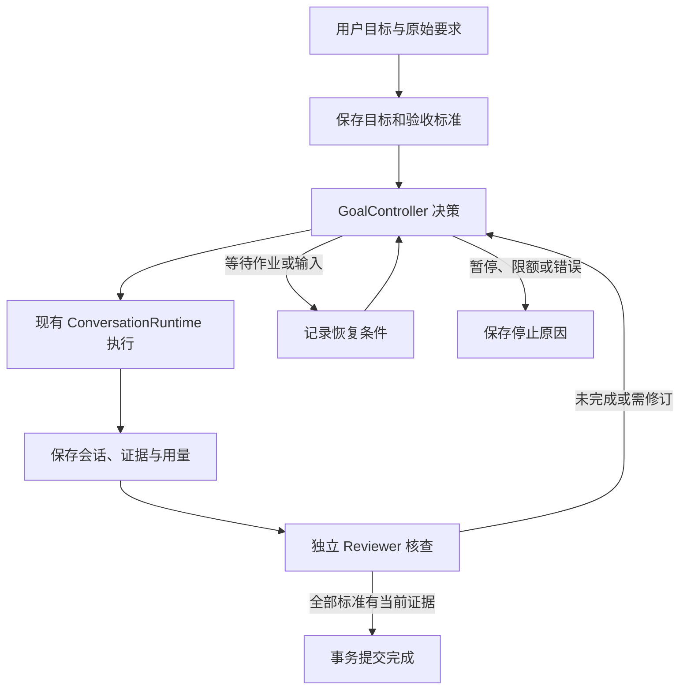

# 基于 OpenHands 的 SomniQ 目标模式构建计划

日期：2026-10-24。状态：待实施的设计计划。项目代码基线：`99243d44f2a8625e124067dc42ced319acfbb721`。

本轮交付目标：把 OpenHands 的目标执行/独立评价循环转成适合现有 Rust + Tauri + React 架构的开发计划，明确模块、状态、完成门禁、交付顺序和验收条件。本文件完成不表示目标模式功能已经实现。

## 1. 要构建的产品行为

用户给出一个目标与完成条件，SomniQ 在同一个持久会话中推进工作。每个执行单元结束后，独立 Reviewer 核查当前证据；控制器根据剩余事项继续、修订、等待、停止或完成。切换页面和收起界面不影响后台控制器。运行期间展示已验证的标准、当前动作、累计用量及停止原因。

首版覆盖代码修复、文献整理、报告等能通过文件、工具输出和产物核查的普通目标。专业研究工作流继续管理自己的阶段顺序，通过适配器接入。完整首版的发布门槛是下文第 1—5 阶段全部通过；第 6 阶段扩展专门工作流的衔接。

启动操作表达执行意图，不再额外询问一次“是否真的执行”。用户已经给出完成标准时直接采用；缺少标准但目标清楚时，由 Executor 提炼、Reviewer 检查是否完整覆盖原需求，再开始工作。只有影响必要决策的真实歧义才进入等待用户状态。读取项目摘要或记录一个目标不自动启动自主执行。

## 2. 从 OpenHands 采用什么

参考固定提交：`OpenHands/software-agent-sdk@acd96e6fa424c02432304395b9208f99be24b54d`。

| OpenHands 结构 | SomniQ 对应设计 |
| --- | --- |
| `GoalController.on_run_finished()` 决定继续或结束 | Rust `GoalController` 根据持久快照与审核结果返回下一动作 |
| `run_goal()` 负责发送消息、运行会话 | `aris-chat` 的 `GoalRunner` 驱动现有 `ConversationRuntime` |
| `judge_goal()` 单独评价目标完成情况 | 复用现有独立 Reviewer，保留身份检查、只读证据工具及真实调用记录 |
| `missing` 形成下一轮 followup | 结构化的未满足标准、缺失证据和修订指令进入下一执行回合 |
| `complete` 与 `capped` 分别返回 | 明确区分已验证完成、轮次用尽、预算耗尽、等待、暂停和错误 |

参考源码：[controller.py](https://github.com/OpenHands/software-agent-sdk/blob/acd96e6fa424c02432304395b9208f99be24b54d/openhands-sdk/openhands/sdk/conversation/goal/controller.py)、[runner.py](https://github.com/OpenHands/software-agent-sdk/blob/acd96e6fa424c02432304395b9208f99be24b54d/openhands-sdk/openhands/sdk/conversation/goal/runner.py)、[judge.py](https://github.com/OpenHands/software-agent-sdk/blob/acd96e6fa424c02432304395b9208f99be24b54d/openhands-sdk/openhands/sdk/conversation/goal/judge.py)。

这里采用控制器与执行驱动分离的设计，在现有 Rust 基础上实现。OpenHands 示例允许相同模型的不同实例担任 judge；SomniQ 继续沿用现有 `review_participants()` 的规则，拒绝相同 provider/model identity。审核 JSON 采用严格类型和语义校验，不使用字符串到布尔值的宽松转换。

## 3. 对现有代码的复用

| 当前落点 | 已核对的能力 | 计划中的用途 |
| --- | --- | --- |
| `crates/runtime/src/project_goal.rs` | 目标、标准、已验证证据、未验证进展和上下文注入 | 保留公共目标接口，增加稳定身份、定义版本和受控完成入口 |
| `crates/runtime/src/conversation.rs` | 单轮执行、工具调用、单轮预算与中断 | 作为内层执行循环，不额外复制一份工具循环 |
| `crates/runtime/src/session.rs` | 会话持久化、压缩历史、未决工具结果的 uncertain 标记 | 保持同会话继续；恢复时先核对未知副作用 |
| `crates/runtime/src/review_workflow_driver.rs` | 从持久状态推导下一步的纯决策函数 | 参考其决策模式；保留专门研究阶段规则 |
| `crates/runtime/src/review_workflow.rs` | run revision、租约及受控状态写入 | 复用语义与可通用的辅助件，不直接共用具体工作流行锁 |
| `crates/chat/src/lib.rs` | provider/model、权限、工具和 ConversationRuntime 的共享组装 | 承载通用 GoalRunner 与 Reviewer 服务端口 |
| `desktop/src-tauri/src/engine.rs` | Reviewer 结果、身份判定、证据收集、审查修订及目标进度更新 | 逐步提取共享合同和策略，保留 Tauri 事件适配 |
| `desktop/src-tauri/src/review_thread.rs` | 隔离 Reviewer 会话、只读工具、独立取消 | 通过 backend 适配器复用其能力 |
| `desktop/src-tauri/src/work_task/` | 后台队列、工作区、审查修订与恢复 | 后续提供任务执行适配器，复用现有任务生命周期 |
| `desktop/src/chat/ProjectBriefCard.tsx` | 项目摘要、目标和 Reviewer 配置状态 | 提供目标入口及运行摘要，与既有 Reviewer 面板协同 |

当前 Reviewer 的一部分实现依赖 Desktop agent thread 和事件存储，不能整体直接移到 `runtime`。提取顺序应是公共数据合同、判定策略、backend 端口，再迁移可共享的调用组装。Desktop 适配器继续负责 AppHandle、窗口事件与应用内线程绑定。

## 4. 模块与运行边界

```text
crates/runtime/src/goal_run/
  mod.rs          公共导出
  model.rs        GoalRun、动作、停止原因和审核回执
  controller.rs   next_action(snapshot)，只作决策
  store.rs        本地事务、版本检查、租约、迁移
  evidence.rs     标准 ID、证据引用和版本有效性
  budget.rs       用量累计、准入和停止策略

crates/runtime/src/review.rs          共享审核合同与身份/结果校验
crates/chat/src/goal_runner.rs        执行、审核、检查点和等待驱动
crates/chat/src/reviewer.rs           可注入 ReviewerBackend 与调用组装
desktop/src-tauri/src/goal_run.rs     命令、配置和事件适配
desktop/src/chat/GoalRunPanel.tsx     目标状态与控制入口
desktop/src/chat/useGoalRun.ts        快照、事件序号及重新读取
```

上述新路径是建议落点，不是已有模块。依赖方向保持 `runtime ← aris-chat ← Desktop`，`runtime` 不依赖 Tauri、React 或上层模型客户端。



## 5. 状态与持久化决定

### 5.1 三层身份

- `ProjectGoal` 表示要实现什么：goalId、goalRevision、原始要求、objective、稳定 criterionId 及完成来源。goalRevision 只在目标定义/标准变化时增加，进度更新不改变定义版本。
- `GoalRun` 表示一次追求该目标的运行：runId、goalId、goalRevision、sessionId、run revision、当前阶段、cycle、预算、停止原因、lease owner/epoch 和当前 attemptId。
- `Session/Turn` 保存实际对话与工具行为，使用已有会话存储。每条执行、审核和用量事件带 runId/attemptId，供去重和审计。

同一目标恢复时保留已有 run、会话和预算累计；扩大预算是显式的配置变更。替换目标产生新的身份，旧 run 的迟到结果只允许补记其真实用量，不允许更新新目标或判定其完成。

### 5.2 持久化选型

建议为目标域使用项目本地 `.somniq/goals.sqlite3`，存储 goal 定义、run、标准、审核回执、证据引用、用量和状态事件。`runtime` 已有 `rusqlite` 依赖。选择事务存储是为了同时提交“目标完成、run 完成和验收回执”，并在 Desktop/CLI 或多个窗口竞争时提供版本检查和租约。

现有 `load/start/pause/resume/complete_project_goal` 等公共接口保留，由内部 store 接管读写。旧 `.somniq/project-goal.json` 作为一次性导入来源，校验并备份；迁移有版本和幂等标记。迁移成功后统一从 store 读取，不能在数据库读取失败时悄悄退回陈旧 JSON。需要可读文件时提供显式导出。

迁移保留旧 objective、状态、successCriteria、verifiedCriteria、recentStatus 和 unverifiedProgress。旧 criterionIndex 映射为稳定 criterionId。历史证据没有 artifact digest 的事实要保留，不能凭迁移补造“已独立验证当前版本”的回执。

### 5.3 运行状态

| 状态 | 含义与恢复 |
| --- | --- |
| `queued` | 已记录执行意图，等待会话调度权 |
| `running` | Executor 正在推进有界工作 |
| `reviewing` | 独立 Reviewer 正在核查 |
| `waiting` | 等待真实作业句柄、权限响应或必要用户输入；记录等待类型 |
| `paused` | 用户暂停或重启后待恢复；不提交新执行回合 |
| `blocked` | 持续性条件阻止继续，必须记录阻塞与恢复条件 |
| `limited` | cycle/token/time 等额度用尽；stopReason 区分具体限制 |
| `failed` | 无法继续的运行错误，保留进展和错误信息 |
| `cancelled` | 用户取消本次运行，禁止旧计时器重新启动 |
| `complete` | 全部目标标准通过独立审核并提交完成事务 |

`stopReason` 补充 `reviewer_unavailable`、`definition_changed`、`recovery_required` 等原因。审核服务不可用采用可恢复停止，不把它当作目标失败或目标通过。

## 6. 审核与完成合同

复用现有 Reviewer 的 read/grep/glob 工具、敏感信息处理、身份限制和取消传播。模型不能创建或控制 Reviewer，也不能通过自报 `independent:true` 获得完成权限；身份、调用 ID 和工具检查记录由宿主写入。

目标审核至少携带以下数据：

```text
GoalReviewRequest
  runId, goalId, goalRevision, cycle, attemptId
  originalRequest, criteria[{criterionId, requirement}]
  evidenceDigest, evidenceRefs[], priorOpenIssues[]

GoalReviewResult
  verdict: complete | continue | revise | needs_user | unavailable
  criteriaResults[{criterionId, satisfied | unsatisfied | unverified, evidenceRefs[]}]
  remainingWork[], revisionInstructions[], summary

ReviewReceipt（宿主生成）
  reviewerIdentity, reviewerCallId, requestIdentity
  goalRevision, evidenceDigest, checkedAt, actualToolChecks[]
```

已有 `IndependentReviewVerdict::Pass` 只表示其审查范围通过。映射为目标 complete 必须同时满足：原始要求被标准完整覆盖；全部标准有符合要求的当前证据；身份有效；目标定义、相关产物版本未变化；没有剩余项；run 仍持有有效调度身份。部分标准通过时返回 continue。

缺字段、未知 criterionId、非布尔/错误枚举、证据缺失、complete 与 remainingWork 冲突、旧版本或迟到回执，都不能完成目标。审核结论只能引用已登记且可核对的证据。Reviewer 不负责执行任意验证命令；需要补跑测试时，交回 Executor 运行并产生记录，再核查结果。

用户手动标记完成如继续保留，要单独记录 `completionSource=user`，不生成独立审核回执。自主模式完成使用 `completionSource=reviewed`。目标改动或相关文件/数据版本变化使对应审核结论失效。

### 避免重复审核

当前 `engine.rs` 已有普通聊天审查/修订循环。GoalRunner 驱动的执行回合标记 `reviewOwner=goal_run`，由外层控制器调用 Reviewer；不能执行一次后先走普通聊天审核，再对同一范围重复审核一次。普通聊天仍使用 turn review owner。

研究工作流或 WorkTask 可以拥有自己的阶段审查，返回带范围和版本的回执；整体目标最终审核检查所有要求的覆盖情况。阶段验收与整体目标验收有不同范围，不能用子任务 PASS 直接完成整个目标，也不能让两个控制器同时调度同一个会话。

## 7. 预算、停止与恢复合同

### 预算

首版建议默认最多 10 个外层执行/审核 cycle，总运行时限 60 分钟，均在启动参数或项目预设中可调整；这两个值是产品建议，不是已有行为。token 上限沿用用户指定的预算预设，未设置时展示未设置，轮次与时限仍有效。

每个 cycle 正常包含一个有界执行单元和一次目标审核。审核解析/网络错误不算成功审计，但调用尝试、实际 token 和耗时照常计入，并有有限重试。已有每轮修订次数不能再无条件嵌套到每个外层 cycle 中。

用量覆盖 Executor、Reviewer、摘要模型、子 Agent、重试，以及正在执行的委托任务；按请求/事件 ID 去重，避免父级汇总与子级明细重复累计。每次模型请求和有成本工具动作前检查剩余额度，限制新请求的输出额度，并为必要收尾留空间。模型调用只能在宿主支持的取消/最大输出范围内限制；不能宣称 token 上限等于精确的账单硬上限。缺失 usage 时标注估算来源，保留调用次数和总时限兜底。

### 停止与人工输入

暂停/取消先持久化意图并使未提交的 attempt 失效，再传播到当前 Executor、Reviewer 和本 run 拥有的可取消请求。已经发生的文件写入或外部动作保留记录。暂停不应顺带终止无关进程；用户取消与停止关联实验作业的效果要由实际工具结果确认。

新用户消息优先取得会话调度权：停止准备中的自动续跑，把当前目标执行置为等待/暂停，处理新要求。新消息不自动改写目标定义；真正的目标变更产生新 goalRevision，旧审核结果不能沿用。已获授权的普通工具操作继续使用现有权限策略，不因启用目标模式扩大权限。

### 检查点与重启

每次调度先落盘 attempt 意图，执行后保存 session/产物证据和实际用量，再写审核结果及下一动作。外部操作未知时复用 `seal_uncertain_tool_calls()` 的语义，先检查其效果，不能因为缺少 tool result 自动重放。

后台执行由 Rust 服务拥有，不依赖 React 挂载或前台标签页。退出整个应用进程时保存停止/未决状态；首版重启后将未结束 run 恢复为 paused/recovery_required，检查关联进程、远程 job、会话和证据后再继续。后台运行不等于机器关机后仍可执行。

租约要在长模型调用期间续期，并以 epoch 拒绝旧 worker 的状态写入。租约过期不能证明外部作业已经终止。等待实验时记录真实 handle、查询方式、最近权威状态和下次检查时间；轮询超时只表示这次观察未完成，不得据此重复提交实验。

## 8. 按六个可评审 PR 交付

| 阶段 | 主要交付与文件 | 可观察验收条件 |
| --- | --- | --- |
| 1：状态与事务存储 | `runtime/goal_run/{model,store,controller}`；改造 `project_goal.rs`；建立迁移 | 旧目标无损导入；稳定 ID 与版本成立；重复启动只得到一个有效 run；目标完成与回执原子提交 |
| 2：共享 Reviewer 合同 | `runtime/review.rs`、`chat/reviewer.rs`；对接 `engine.rs` / `review_thread.rs` | provider/model 独立性规则保留；结构化审核严格解析；缺证据不能通过；原有聊天审查回归通过 |
| 3：共享执行闭环 | `chat/goal_runner.rs`，接现有 ConversationRuntime、用量与取消；加入唯一 review owner | 使用替身 Executor/Reviewer 完成“执行→拒绝→修订→通过”；跨轮自动继续；达到预算准确停止；每回合只有一个审查调度方 |
| 4：桌面入口与可见状态 | Tauri `goal_run_*`、`api/tauri.ts`、`GoalRunPanel`、`useGoalRun`、ProjectBrief 入口 | 能启动/暂停/继续/取消；切换页面后持续执行；重载能恢复 UI 快照；用户看到标准与证据、费用来源和停止原因 |
| 5：恢复与并发完整性 | run lease/epoch、启动恢复、证据失效、会话仲裁和端到端用例 | 在执行后/审核后/完成事务前后中断均可正确恢复；取消后的旧事件不续跑；人工输入不与后台回合并发；产物变化撤销相关通过结论 |
| 6：科研工作流衔接 | `workflow.rs`、`review_workflow_driver.rs`、WorkTask 和等待适配器 | 目标能委托现有 workflow/task；阶段审查结果可追溯；不重复拉起现有实验；总目标完成覆盖最终交付标准 |

依赖顺序：1 → 2 → 3 → 4 → 5，完成首版验收后进入 6。第 1 阶段可先明确第 2 阶段合同形状，避免存储反复改动。各 PR 的行为只在其所需依赖齐备时启用。

建议 MVP 中的 `/goal start` 发起持久目标和 run，`/goal resume/pause/status/cancel` 映射到共享命令；新面板复用同一 API。`projectBriefGet` 继续提供项目连续性，新增 `goal_run_snapshot` 提供执行状态。历史目标读取不再隐含启动。

事件建议统一为 `goal_run_changed`，含 projectId、runId、revision 和最新阶段；前端先订阅再取 snapshot，依据 revision 处理重复/乱序事件，重连时重新取快照。进度展示区分执行器自报与 Reviewer 已验证结果。

## 9. 必须通过的验收场景

| 场景 | 预期结果 |
| --- | --- |
| Executor 声称完成但没有测试/产物证据 | Reviewer 要求补证据，目标继续或修订 |
| 部分标准通过，其余仍缺失 | 保存已验证部分，整体继续；不提前 complete |
| 第一次审核拒绝，下一轮补齐后通过 | 自动修订并完成，保留每次证据和结论 |
| Reviewer 未配置、与 Executor 同身份或不可用 | 启动前/运行中给出明确原因，不回退为自评完成 |
| 审核 JSON 给出 `complete:"false"`、未知标准或矛盾剩余项 | 严格拒绝完成，有限重试或可恢复停止 |
| cycle/token/time 任一预算耗尽 | 记录 limited 和具体原因，保留进展与下一步 |
| 审核持续失败或解析失败 | 真实用量继续累计；重试有界，不无限续跑 |
| 执行、审核或准备续跑时暂停/取消 | 意图先落盘，旧 attempt 不再生成新工作 |
| 自动续跑期间人工发送新请求 | 用户消息先处理，后台不同时写同一会话 |
| 重复事件、延迟结果、双窗口/CLI 同时启动 | 单个有效调度者、幂等状态迁移和一次用量记账 |
| 执行后崩溃，工具结果未落盘 | 标记未知效果并核查，避免重放外部副作用 |
| 审核通过后崩溃或完成提交中断 | 从检查点/事务状态恢复，不重复执行已完成目标 |
| 审核后代码、数据或目标定义改变 | 旧回执失效，相关标准重新检查 |
| 等待实验，某次查询超时 | 继续核对同一个真实 job，避免重复提交 |
| 关闭面板、切换项目、重新打开应用 | Rust 后台生命周期和可恢复状态与 UI 分离 |
| 旧 JSON 迁移/重复迁移/迁移中断 | 数据保留、迁移幂等；失败不启动新 run 或回退到旧状态 |

首个真实演示可选“修复一个预置失败的测试，运行检查并交付结果”，验收必须看到实际命令结果与独立审核记录。第二个用例选择“在有界检索范围内整理文献并形成带出处的报告”，检查证据追溯和停止条件。替身用例负责确定性覆盖竞态，真实模型用例负责验证端到端接线；两者不能互相替代。

## 10. 验证与交付标准

开发时先运行改动相关的 focused tests；跨 crate 改动再跑 `cargo test --workspace`。Desktop 是独立 Cargo workspace，需要额外运行 `cargo test --manifest-path desktop/src-tauri/Cargo.toml --lib` 的相关 native tests，不能用根工作区通过代替原生层验证。

建议新增测试集中在 `crates/runtime/src/tests/goal_run/`、`crates/chat/src/tests/goal_runner.rs`、`desktop/src-tauri/src/tests/goal_run.rs` 与 `desktop/src/chat/tests/GoalRunPanel.test.tsx` / `useGoalRun.test.tsx`。具体模块注册随各 PR 落地；这些是待创建的测试路径。

UI/Tauri API 改动运行 focused Vitest、`npm run typecheck` 和 `npm run build`。发布前检查普通聊天、既有 Reviewer、WorkTask 和研究工作流的相关回归，并在 Windows 做一次实际暂停、重启与完成演示；现有 macOS CI 继续覆盖跨平台构建。

首版完成的判据：用户给一次明确目标，系统能跨至少两个执行/审核 cycle 自主推进；独立 Reviewer 能推翻无证据完成声明；预算和人工停止可靠；重启可恢复且不重复外部操作；最终交付的每条验收标准都能追溯到当前版本证据。发布、合并 PR 或对外发送信息继续使用原有显式授权边界。

本次仅交付构建计划，未运行上述实施阶段的测试或启动产品改造。设计依据和上游实现差异见 [GitHub 调研](goal-mode-github-survey.md)。
