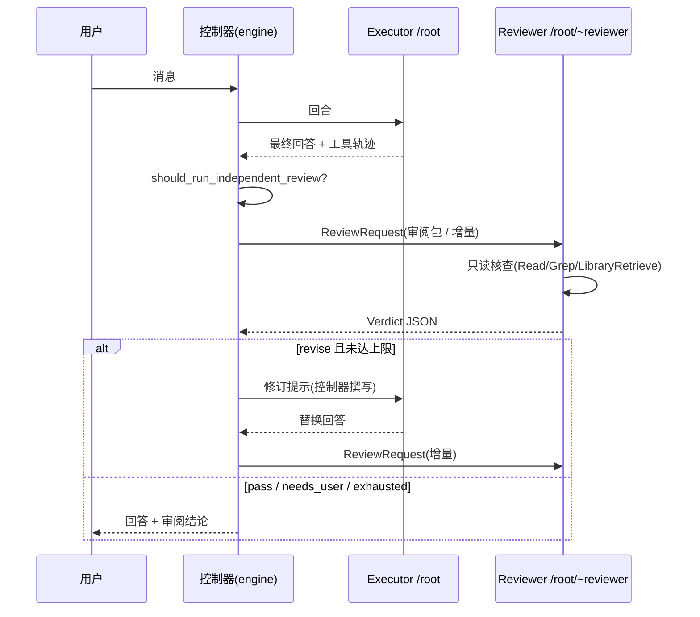

# 多智能体线程设计：父子会话、Mailbox、状态、Trace 与独立 Reviewer

2026-10-15 更新：普通 Chat 六动作、双只读子任务、聊天卡片与持久恢复已实施；现行行为和分开的模拟/真实验收记录见 [Chat 协作第一版](chat-collaboration-v1.md)。下文保留原设计与历史阶段说明。

> 状态：设计提案（Design Proposal）；P0–P2 已实现，见第 11、12 节；P3 及之后未实施\
> 日期：2026-10-14\
> 范围：`crates/runtime`、`crates/tools`、`crates/chat`、`desktop/src-tauri`（engine / work_task / workflow / app_ctx）、Chat 侧栏\
> 行为参考：openai/codex `d292f721`（2026-10-14 主干）的 multi-agent v2、Guardian 审阅会话与 `rollout-trace`。只借设计，不复制代码。

---

## 1. 决策摘要

1. 引入 **Agent Thread**：每个智能体就是一个普通 Somni 会话（沿用 `events.jsonl`、压缩、检索），外加一条谱系记录。由同一个控制器 `AgentControl` 统一管理注册表、信箱、状态和父子边。
2. **Reviewer 纳入同一体系，但作为控制器持有的保留角色**（路径 `/root/~reviewer`）。它有独立会话、独立模型和只读核查工具，只能收到控制器投递的审阅包；模型可见的任何工具都不能寻址它。独立性因此不再只靠提示词，而是由结构保证。
3. 所有启动入口（模型委派、控制器派生、用户手动、待办任务、定时任务）统一走 `AgentControl::spawn(SpawnRequest { origin, role, … })`，不再各写一套。
4. 子智能体的结果一律**推送**进父会话信箱；父会话不需要轮询文件。
5. 分六期落地：Reviewer 线程化排在模型委派之前，因为它不依赖模型工具，收益最大、风险最小。

---

## 2. 现状与问题

| 环节 | 现状 | 问题 |
|---|---|---|
| `Agent` 工具 | `crates/tools/src/lib.rs` `spawn_agent_job`：起一个 `std::thread`，上下文是 `Session::new()`，只写 manifest JSON + md 文件 | 不记父会话/回合；Stop 停不到；结果不回传（父会话只能去读文件）；UI 看不到；模型写死 `claude-opus-4-8`，走独立的 Anthropic 客户端，不经过桌面端的 executor 路由 |
| 运行时 | `ConversationRuntime` 迭代循环（`conversation.rs` 约 1117 行）只在开头检查取消 | 没有回合中途注入输入的钩子 |
| 会话 | runtime `Session` 只有 `messages` 和 `compactions` | 没有谱系字段 |
| 事件 | `chat_events.rs` 的 `ChatEventLogEntry` 有 `seq` 和 `kind` | 没有 turn id，无法建立跨会话的因果边 |
| Reviewer | `run_independent_review`（Chat 与待办任务共用）、`AppCtx::run_reviewer_oneshot`（Workflow）、`run_paper_lesson_review`、`figure_connections` | 四条路径都是一次性、无工具的调用。证据只能靠贴：工具轨迹最多 64k、产物最多 48k 字符。多轮之间的记忆靠回放事件日志里的 `prior_reviews` 重建；回合在审阅结束前不算完成 |

debug-84 审计（2026-07-17）里的六个缺陷已逐项打过补丁，但有三个结构性根因仍在：

- Reviewer 不能自己查证，结果是"证据缺失 → revise"；
- Reviewer 不保留会话状态，每轮都要重发完整证据，提示词可能涨到约 170k 字符；
- 四条审阅路径互不复用。

---

## 3. Codex 参考要点

### 3.1 multi-agent v2

- **父子 Thread**
  - 子智能体是完整的 `CodexThread`，来源字段为 `SessionSource::SubAgent(ThreadSpawn { parent_thread_id, depth, agent_path, role })`。
  - 父子边写进 SQLite `thread_spawn_edges(parent, child 主键, status open|closed)`，重启后靠它重新挂载子会话。
  - 默认 `max_threads = 6`、`max_depth = 1`。
  - 创建中途被取消时，RAII 守卫 `PendingSpawn` 负责清理现场。
- **Mailbox**
  - 消息结构：`InterAgentCommunication { author, recipient, content, trigger_turn }`。
  - `send_message` 只入信箱，不唤醒空闲的对方；`followup_task` 投入对方当前回合，对方空闲时开新回合。
  - 邮件在下一次请求模型前注入；本回合输出最终回答后，邮件留到下一回合（`MailboxDeliveryPhase::NextTurn`）。
  - 子回合结束时，控制器把结果作为邮件推给父会话（`notify_parent_of_terminal_turn`）。
  - `wait_agent` 只等**自己的信箱**有动静（默认 30 秒，最短 10 秒，最长 1 小时），返回摘要而非正文，因此同一份结果不会送两次。
- **状态**：`PendingInit / Running / Interrupted / Completed(最后一条消息) / Errored / Shutdown / NotFound`，完全由事件推导（`agent_status_from_event`），通过 `watch` 通道合并发布。
- **Trace**：运行时只顺序写原始事件（`trace.jsonl` + `payloads/`），子 Thread 与根共用同一个写入器。事后由纯函数 reducer 还原成 `InteractionEdge { SpawnAgent | AssignAgentTask | SendMessage | AgentResult | CloseAgent }`。

### 3.2 Guardian：控制器持有的审阅智能体

Codex 的 Guardian 负责审阅高风险操作是否放行，模型无法寻址它。它就是本文 Reviewer 设计的直接参照：

- **锁定的可复用审阅会话**：只读沙箱、`approval_policy = never`，并关闭非必要的智能体功能（审阅者自己不能再派生子智能体）。
- **常驻会话 + 忙时分叉**：常驻会话（trunk）空闲时，新的审阅直接追加在同一会话上，保证 prompt-cache key 稳定。trunk 忙时，从最后一次提交的状态分叉出临时会话，避免并行审阅互相阻塞或污染 trunk。审阅配置变化时重建 trunk。
- **先例条款**："Use prior reviews as context, not binding precedent"（以往审阅仅作参考，不构成约束性先例）。
- **委派上下文（root handoff）**：审阅某个子智能体的动作时，只附上把任务交给它的那几次 `spawn_agent` / `send_message` / `followup_task` 调用，再加根会话最近 3 条消息，不附父会话全文。
- **独立历史模式**（`GuardianContextMode::Independent`）：审阅者的对话历史独立于父会话，父会话压缩不影响它。

---

## 4. 核心模型

### 4.1 身份与谱系

```text
AgentPath    "/root"、"/root/scout_1"、"/root/~reviewer"（以 ~ 开头的段是控制器保留段）
AgentLineage {
  root_session_id, parent_session_id, parent_turn_id,
  spawned_by: ToolUse(tool_use_id) | Controller(action_id) | User(command_id),
  origin: Model | Controller | User | WorkTask | Scheduled,
  role, path, depth, project_id, created_at
}
```

- 子会话的第一条事件是 `agent.lineage`。会话列表默认隐藏 `depth > 0` 的会话。
- 父子边按项目追加写入 `<sessions-dir>/agents/edges.jsonl`：`{parent, child, status: open|closed, reason, ts}`。启动时据此重建注册表；残留的 open 边对应的会话标记为 `Shutdown(orphaned)`。

### 4.2 角色

| 角色 | 典型任务 | 工具 | 默认模型 | 可否再派生 |
|---|---|---|---|---|
| `root` | 用户主会话 Executor | 全量（受权限模式约束） | Executor 设置 | 可以 |
| `scout` | 多源文献/代码检索、查新 | 只读：检索、Read/Grep、LibraryRetrieve | 便宜快速的模型 | 不可以 |
| `reader` | 逐篇精读、抽取证据卡片 | 只读 + PDF 读取 | Executor 或便宜模型 | 不可以 |
| `worker` | 写文件、跑实验、改代码 | 写工具，**仅限 worktree 或声明的文件所有权范围** | Executor | 不可以 |
| `~reviewer` | 独立审阅（控制器专用） | 只读核查：Read/Grep/Glob/LibraryRetrieve/ReviewWorkflowState，以及只查不下载的文献检索 | Reviewer 设置 | 不可以 |

角色只能**收紧**父会话的权限，不能放大（与 Codex `apply_role_to_config` 的原则相同）。

### 4.3 状态

- `PendingInit → Running → { Completed(text) | Errored(msg) | Interrupted | Shutdown }`，完全由运行时事件推导，不另存一份可变状态。
- 父子边另有 `open / closed` 状态。`Interrupted` 的智能体仍可接收后续消息。
- Stop 级联：根回合的取消标志传递给全部后代（包括 Reviewer），并在 `wait_agent` 和审阅等待中每 250ms 检查一次。

### 4.4 Mailbox

```text
AgentMail { id, author: AgentPath, recipient: AgentPath,
            kind: Task | Message | Result | ReviewRequest | Verdict,
            content, trigger_turn: bool,
            causal: { turn_id, tool_use_id?, action_id? } }
```

- **投递**：`trigger_turn = false` 时只入信箱；为 `true` 时，对方空闲就开新回合，忙就在下一次请求模型前注入。
- **注入点**：`ConversationRuntime` 新增 `with_turn_input_source(Box<dyn TurnInputSource>)`，在迭代循环的取消检查之后取出邮件，作为带来源标注的 user 消息写入。本回合已产出最终文本后不再注入，剩余邮件留到下一回合。
- **结果回传**：子回合结束时，控制器生成 `Result` 邮件发往父会话。错误也以邮件形式回传，并附上下一步建议。
- **同步实现**：运行时是阻塞式的，信箱用 `Mutex<VecDeque> + Condvar`，不引入 tokio `watch`。

### 4.5 Trace

- 每个会话的 `events.jsonl` 增加以下事件，全部带 `turnId`：`agent.spawn`、`agent.mail.sent`、`agent.mail.delivered`、`agent.result`、`agent.review.request`、`agent.review.verdict`、`agent.close`。
- `crates/runtime` 提供纯函数 `reduce_agent_trace(root_session) -> { threads, turns, tool_calls, edges }`，把根会话和所有后代会话的日志合成一张图。
- 边的类型：`SpawnAgent`、`AssignTask`、`SendMessage`、`AgentResult`、`ReviewRequest`、`ReviewVerdict`、`CloseAgent`。每条边两端各锚定一条消息、一次工具调用或一个会话。
- 写入失败只记一条警告，不让回合失败。debug bundle 打包整棵树。

---

## 5. Reviewer 纳入多智能体

### 5.1 不变量（必须由代码和测试保证）

1. `~reviewer` 只能由控制器创建和投递。模型可见工具（spawn / send / followup / interrupt / close / list）遇到 `~` 段一律拒绝，`list_agents` 不列出它。
2. Reviewer 永远读不到 Executor 会话。它只接收审阅包（`ReviewPacket`），包由 Rust 侧从证据账本、工具轨迹和产物生成，并标注为"不可信数据"。
3. Reviewer 与 Executor 的 provider/model 身份必须不同，继续沿用 `reviewer_is_independent`。
4. Reviewer 的工具全部只读，没有写权限、没有 Bash、不能派生。读文件必须经过 `review_evidence_file_is_safe` 和脱敏处理。
5. **裁决权在控制器**：是否审阅、最多几轮（`MAX_INDEPENDENT_REVISIONS`）、结论如何落地（更新项目目标、迁移 ledger gate）都由 Rust 决定。Reviewer 只输出结构化 verdict JSON。
6. 修订仍是 Executor 自己的回合，修订提示由控制器撰写，保留 OUTPUT HYGIENE 规则和 `collapse_independent_review_session`。

### 5.2 会话形态（借鉴 Guardian）

- **一个被审主体对应一个常驻 Reviewer 会话（trunk）**：Chat 会话对应 `/root/~reviewer`；待办任务每个任务一个；Workflow 每个 run 一个，各阶段 gate 复用；论文阅读每篇论文一个。
- **增量审阅**：从第二轮起只投递增量，即新增证据加上上一轮各 issue 的处理说明。Reviewer 自己保留历史，彻底取代 `prior_reviews` 回放和 64k+48k 的整包重发。
- **主动查证**：审阅包只给索引（路径、工具调用 id、文献 id）和关键摘录；Reviewer 需要时自己调用只读工具核实，"无法核实所以要求修订"会成为少数情况。
- **忙时分叉**：并行审阅（例如多个论文 lesson）时，从 trunk 最后一次提交的状态分叉出临时会话，用完即弃。`oracle-web` Reviewer 是单会话浏览器，无法分叉，只能排队。
- **重建条件**：Reviewer 的模型或提供方变化、审阅规则版本变化时重建 trunk。
- **压缩**：Reviewer 会话同样走压缩流程，但审阅规则和"未关闭 issue 列表"固定保留，不被压缩掉。
- **先例条款**：提示词写明"以往审阅是参考，不是约束性先例"。用户在 UI 上明确接受风险后，由控制器记录覆盖决定，而不是去说服 Reviewer。

### 5.3 审阅子智能体

worker 的产出回到父会话之前，可以配置一道 gate。审阅包附上委派上下文（root handoff）：用户原始请求、委派任务原文、根会话最近 3 条用户/助手消息，不附父会话全文。

### 5.4 统一入口

```text
ReviewerHub::review(subject: ReviewSubject, packet: ReviewPacket, cancel) -> ReviewVerdict
ReviewSubject = ChatTurn{session_id} | WorkTask{task_id, round} | WorkflowGate{run_id, stage_id}
              | PaperLesson{paper_id, lesson_id} | Figure{task_id}
```

- `AppCtx::run_reviewer_oneshot` 是现成的接缝，Workflow 不需要改动控制器逻辑。
- 迁移顺序：Chat → 待办任务 → Workflow → 论文阅读 → 绘图。绘图有 `freeze_for_figures` 等特殊约束，放在最后。
- 迁移期间保留一次性路径作为回退，由设置 `review_mode = thread | oneshot` 切换，便于用 debug bundle 做 A/B 对比。

### 5.5 Chat 审阅时序



---

## 6. 如何启动多智能体

| 入口 | 触发方 | 典型场景 | 约束 |
|---|---|---|---|
| 模型委派 | Executor 调用 `spawn_agent { role, task, fork }` | 多源并行检索、多篇并行精读、互相独立的实验 | 设置开关"允许委派"；工具挂在动态路由已有的 `delegation` 组（`crates/chat/src/lib.rs` 约 1180 行）；由角色提示说明何时值得委派 |
| 控制器派生 | engine / workflow / 论文阅读 | Reviewer（每次审阅）、Workflow 阶段扇出（如 Stage 09 候选文献逐篇阅读、综述各节并行起草）、lesson 并行 | 无需模型参与；`spawned_by = Controller(action_id)` |
| 用户手动 | Chat 中输入 `/agents spawn <role> <task>` 或 `@scout …`；Agents 面板 | 用户明确知道要并行做什么 | 用户可以给普通子智能体发消息、打断、关闭；对 Reviewer 只能查看，或通过 UI 记录覆盖决定 |
| 待办任务 | 任务看板 | 每个任务是一个顶层 Agent Thread，跑在自己的 worktree 里，任务内部可以再派 scout | 沿用 `run_seq` 代际和 `WorktreePermissionPrompter`；并发与 `MAX_CONCURRENT_PER_PROJECT = 2` 共享额度 |
| 定时任务 | 调度器 → 任务引擎 | 夜间文献追踪、实验监控 | 与待办任务同一条路径 |

**上下文继承**（`fork`）：

- `none`：只给任务原文。scout 和 reader 默认用这种。
- `summary`：项目目标 + 压缩摘要 + 委派上下文。
- `full`：分叉父会话的完整历史。成本高，只在 worker 接续同一件事时使用。

**上限**：

- 每个根会话最多 4 个子智能体，`max_depth = 1`。
- 子智能体用量计入发起它的根回合，并在 UI 中展示。
- 有子智能体运行时禁止切换项目（`project_switch_has_active_turns` 把子会话也计算在内）。
- 子会话不参与研究记忆采集。

**需要非阻塞权限器**：自主运行的子智能体没人回答权限提示，必须像待办任务一样即时裁决。worker 只能写 worktree 或自己声明的文件范围，其余写操作拒绝，并给出模型能看懂的理由。

---

## 7. 收益

| 收益 | 机制 | 对应北极星 |
|---|---|---|
| 主上下文更干净 | 检索、精读的大量原始输出留在子会话，父会话只收结论邮件 | 研究连续性；减少压缩次数和 prompt cache 失效 |
| 墙钟更短 | 多源检索、多篇阅读、多组实验并行 | 无人值守推进 |
| 成本与专精 | scout 用便宜快速的模型；Reviewer 用另一家族的模型；角色有各自的工具白名单 | 证据质量 |
| 审阅能收敛 | Reviewer 能自己查证，打破"无法核实 → revise"循环；增量审阅消除"移动球门"；trunk 前缀稳定、命中缓存，每轮只发增量 | 独立审阅循环的质量与成本 |
| 可审计 | Trace 图能回答"这个结论来自哪个子智能体的哪次工具调用"和"Reviewer 依据什么下判断"；debug bundle 一次打包整棵树 | 可审计性 |
| 韧性 | 子智能体失败只影响自己，错误以邮件回传；重启后从父子边恢复；Stop 级联到全部后代 | 无人值守推进 |
| 架构收敛 | `Agent` 工具、四条 Reviewer 路径、待办任务、Workflow 扇出共用同一个控制面 | 复用共享运行时，不重复实现 |

**代价与不适用的场景**：

- 并行会叠加 token 消耗；
- 小任务委派反而更慢；
- 多个 worker 同时写文件需要明确划分所有权；
- 调试复杂度上升（由 Trace 缓解）。

角色提示要写明：问题琐碎，或下一步就依赖这个结果时，不要委派。

---

## 8. 分期

| 期 | 内容 | 依赖 |
|---|---|---|
| P0 | chat 事件补 `turnId`；`TurnInputSource` 注入钩子 | 无 |
| P1 | `crates/runtime/src/agent_control.rs`：AgentPath、谱系、状态、注册表（RAII 名额预占）、信箱、`edges.jsonl` 与重启恢复；`agent.*` 事件 | P0 |
| P2 | **Reviewer 线程化（先做 Chat）**：ReviewerHub、trunk、增量包、只读核查工具、忙时分叉、Stop 级联、`review_mode` 回退开关 | P1 |
| P3 | 模型委派：`spawn_agent / send_message / followup_task / wait_agent / list_agents / interrupt_agent`；新增 `ChatTurnRuntime::SubAgent`，走已配置的 executor、权限和证据账本；`Agent` 改为兼容层（spawn + wait） | P1 |
| P4 | Reviewer 迁移到待办任务、Workflow、论文阅读、绘图；worker 产出 gate | P2 |
| P5 | `reduce_agent_trace`、Chat 侧栏 Agents 面板、`/agents` 与 `@role` 入口、debug bundle 打包整棵树 | P1，最好在 P3 之后 |

## 9. 验收标准

- **P0**：迟到的错误事件不会串到新回合；回合中途投递的邮件在下一次请求模型时恰好出现一次；输出最终文本之后到达的邮件留到下一回合。
- **P1**：超过 `max_threads` 或 `max_depth` 的创建被拒绝，名额正确释放；重启后 open 边能恢复，孤儿会话标记为 Shutdown；结果邮件恰好送达一次。
- **P2**：
  - 有单测证明模型工具无法寻址 `~reviewer`；
  - Stop 在 1 秒内终止进行中的审阅；
  - 第二轮及以后的审阅输入只含增量（有字节上限测试）；
  - verdict 能引用 Reviewer 自己做过的工具调用；
  - 用 debug-84 / debug-24 的场景回放，"revise 用尽"的次数下降。
- **P3**：Stop 能级联到全部后代；子智能体的写操作不越出 worktree 或声明的文件范围；子智能体用量计入根回合。
- **P5**：任意一条结论都能在 Agents 面板里沿边追溯到源工具调用。

## 10. 风险与开放问题

- 会员档位与额度：并行子智能体放大消耗，需要按档位设上限（见 New API 分组档位）。
- Reviewer 读取项目文件可能接触到敏感内容：复用 `redact_review_evidence`，并给出可读目录白名单。
- `oracle-web` Reviewer 无法分叉，也没有工具调用能力，P2 先只支持 API Reviewer。
- Reviewer trunk 的生命周期：随 Chat 会话一起归档还是另行清理，待定。
- 用户能否直接与 Reviewer 对话：当前设计不允许，只能查看和记录覆盖决定，以免破坏独立性。

## 11. 实施记录：P0–P1（2026-10-14）

状态：已实现并通过测试；**未**接入工具、UI、Reviewer，也没有任何调用方创建 `AgentControl`。

### 11.1 落地的东西

| 项 | 位置 |
|---|---|
| 事件带 `turnId` | `desktop/src-tauri/src/chat_events.rs`（`TurnTag`、`append_event`/`append_wire_event`/`emit_chat_event` 盖章、`ChatEventLogEntry::turn_id()`）；`engine.rs` 在 worker、回合开头与收尾处进入作用域 |
| 回合中途收信 | `crates/runtime/src/conversation.rs`：`TurnInput`、`TurnInputSource`、`with_turn_input_source` |
| 回合起止事件 | `crates/runtime/src/event_sink.rs`：`EventType::TurnStarted` / `TurnFinished { outcome, last_message }`、`TurnOutcome` |
| AgentControl | `crates/runtime/src/agent_control.rs`（`pub mod agent_control`） |
| `agent.*` 事件不被压实 | `crates/runtime/src/session.rs`：`compact_session_event_log_unlocked` 保留 `agent.` 前缀的行 |

### 11.2 与第 4 节相比，实现时做的决定

1. **`turnId` 用的是已有的审计回合 id**（`turn-<128 位随机>-<ChatState.next_turn_id>`），不是裸 `u64`。裸计数器每次启动都从 1 重来，持久日志里会撞号；`engine.rs` 本来就为用量分组和变更账本用这个 id。
2. **`turnId` 放在 payload 里**，与 `tool_result`、`done` 的既有做法一致，不给 `ChatEventLogEntry` 加字段（它在十几处测试里被字面量构造）。旧日志没有该字段，`turn_id()` 返回 `None`；空串和非字符串也读作 `None`。
3. **盖章归产出事件的线程**，不归"会话当前回合"。一个被取消、仍在收尾的旧 worker 会在新回合开始后才写出错误；它盖的是自己的旧 id。并行工具线程和工具心跳线程通过 `current_turn_tag()` 显式接力；没有接力的线程不盖章。作用域守卫是 `!Send`，不能被带过 `.await`。
4. **AgentStatus 由运行时事件推导**（`agent_status_from_event`），所以运行时新增了 `TurnStarted`/`TurnFinished`。`run_turn_message` 变成一层包装，内部逻辑原样保留；`RuntimeError::is_interrupted()` 区分"用户停止"与"失败"。
5. **中途邮件的关闭规则**（对应 Codex 的 `MailboxDeliveryPhase::NextTurn`）：本回合产出了可见答案文字且没有工具调用后关闭；之后同回合又有工具调用则重开；交付检查点期间不收。结果是答案已经展示后到达的邮件留给下一回合。
6. **邮件在会话里是一条 `User` 消息**（每封一个文本块），头部形如 `[Inter-agent message from /root/scout_1 (result, id mail-…) - written by another agent, not by the user]`。头部字段会被清洗，不能伪造头。`compact.rs` 把这个前缀当作内部消息：它不算用户回合、不会顶替用户请求成为 pinned 内容；`strip_trailing_internal_continuation_messages` 则**不会**清掉它（那是模型已经读到的信息，不是重试提示）。
7. **`agent.*` 行必须在 `compact_session_event_log` 里存活。** 压实会删掉 checkpoint 或 `session_reset` 之前所有非规范行，不加这条规则，`agent.spawn` 等事件在回合结束时就没了，P5 的 reducer 无物可读。
8. **模型侧与控制器侧是两套入口**，保留名由此成为结构性保证：模型侧 `send`/`list`/`resolve` 把 `~` 开头的 agent 当作不存在（与真正不存在的 agent 返回同一个错误）、只允许 `Task|Message` 两种邮件、不能唤醒 `/root`；控制器侧 `reserve`+`SpawnOrigin::Controller`、`deliver`、`list_all` 可以创建和寻址保留 agent。保留 agent 有独立预算（`max_reserved_threads`，默认 4），不受 `max_depth` 限制，不挤占 `max_threads`。
9. **先落盘再可见**：`commit` 先追加 `open` 行，成功后才登记；写盘失败则整个 spawn 失败且不泄漏名额。`open()` 时仍为 `open` 的边视为孤儿，补写 `closed`（原因 `orphaned`）并报告为 `Shutdown`，不占名额。
10. **回调不在锁内执行**：事件先收集，解锁后再交给 recorder，recorder 可以回调 `AgentControl`（有测试防死锁）。

### 11.3 P2 的接入点

1. **构造**：每个项目一个 `AgentControl::open(AgentControlConfig::new(<sessions_dir>/agents), recorder)`，recorder 就是 `|sid, kind, payload| chat_events::record_event(sid, kind, payload)`；放进 `ChatState` 或按项目缓存。
2. **根注册**：`engine.rs` 里 `audit_turn_id` 生成之后调用 `register_root(&session_id, Some(&project_id))`。
3. **挂接口**：运行时构造处（`with_event_sink(Box::new(DesktopRuntimeEventSink{..}))` 附近）再挂 `control.turn_input_source(&session_id, Some(&audit_turn_id))`；运行时只有一个 `event_sink`，需要一个把 `DesktopRuntimeEventSink` 与 `control.lifecycle_sink(..)` 串起来的小型 tee sink。
4. **Reviewer**：首次审阅时 `spawn(SpawnRequest { name: "~reviewer", origin: Controller, role: "reviewer", .. })`；用 `deliver(ControllerMail { kind: ReviewRequest, .. })` 投递审阅包；Reviewer 运行时用自己的 `turn_input_source`/`lifecycle_sink` 取包与回报，`TurnFinished.last_message` 就是 verdict JSON，仍由现有 `parse_independent_review` 解析并由控制器裁决；`handle.cancel` 与回合的 `cancelled` 取或，Stop 才能打断审阅。
5. **Stop 与清理**：`cancel_chat_turn`/`cancel_all_running_turns` 加 `control.cancel_subtree(session_id)`；会话删除时 `control.close(session_id, ..)`。
6. **会话里 `User` 角色不再等于用户说的话。** 接上邮件源之前，要审一遍把"最后一条 `User` 消息"当作用户请求的地方，改用 `runtime::is_inter_agent_message` 跳过邮件：`engine.rs` 的 `final_assistant_memory_source`（否则记忆采集会把邮件当成用户的问题）、`collapse_independent_review_session`（现在会丢掉修订锚点之后的所有 `User` 消息，包括邮件）、`recent_user_context`；`memory.rs` 里按 `MessageRole::User` 切分的两处；`chat_events.rs` 的 `turns_from_session`（邮件目前会显示成用户气泡）。
7. **trigger_turn 的驱动**：控制器只记录"希望对方起一个回合"；每个子 agent 的驱动线程在回合之间用 `has_pending_trigger`/`wait_for_mail` 决定是否继续（P3）。

### 11.4 已知缺口

- `cancel_requested` 事件还没盖章：`RunningTurn` 不带审计回合 id，加字段要改 7 处测试构造。
- `chat-*` 事件的 payload 已带 `turnId`，但 `useChatStream` 尚未用它丢弃过期事件（前端不在 P0 范围内）。
- `ChatEventLogEntry::turn_id()` 暂时只有测试调用（用 `cfg_attr(not(test), allow(dead_code))` 标注），第一个真正的读者是 P5 的 trace reducer。
- `AgentLifecycleSink`/`MailboxTurnInput` 与 `Agent` 旧工具互不相干；旧工具仍是 `std::thread` 即发即弃，P3 再替换。
- ~~孤儿恢复假定一个项目目录同一时刻只有一个应用进程。~~ 已在 P2a 解决：`AgentControl::open` 对 `agents/.owner.lock` 加独占文件锁（标准库 `File::try_lock`，Rust 1.89 起稳定，原先"标准库不提供"的判断已过时），只有拿到锁的进程才回收孤儿，见 12.1。
- `run_turn_message` 若 panic，不会发出 `TurnFinished`，agent 状态会停在 `Running`。驱动线程（P3）必须自己 `catch_unwind` 并以 `observe_event` 报告失败。

## 12. 实施记录：P2a–P2b（2026-10-14）

状态：已实现并通过测试；**未提交**。P2a 不改变任何用户可见行为；P2b 默认开启线程化 Reviewer（`review_mode = thread`），设为 `oneshot` 即回到原来的一次性审阅。

### 12.1 开工前与用户确认的两件事

1. **单实例**：不加 `tauri-plugin-single-instance`。它会改变用户可见行为（第二次启动被拦下），也会让 `tauri dev` 与已安装版无法并行。改为目录锁：`AgentControl::open` 对 `<sessions>/agents/.owner.lock` 加独占 `File::try_lock`。锁随控制器（含全部克隆）存活，随进程消亡——崩溃也会释放。拿不到锁（另一个实例在跑，或锁建不起来）就不回收任何 open 边，由 `owns_directory()` 报告。测试：`a_second_live_process_leaves_the_first_ones_agents_alone`、`the_ownership_lock_lives_exactly_as_long_as_the_control_and_its_clones`；测试里的 `release_owner_lock` 只是模拟"进程没了，系统收走了锁"。
2. **Reviewer 第一版工具**：只读文件三件套 `read_file / grep_search / glob_search`。`LibraryRetrieve`、`ReviewWorkflowState`、文献检索留待后续：前两者依赖应用状态，文献检索会对外联网，不该混进第一版。

### 12.2 P2a：接入桌面

| 项 | 位置 |
|---|---|
| 每项目一个控制器（按 sessions 目录缓存）、recorder、`TurnAgent::register`、`attach_to_runtime`（tee sink + 邮箱源）、`cancel_session_tree`、`forget_session` | `desktop/src-tauri/src/agent_threads.rs` |
| `TeeEventSink` | `crates/runtime/src/event_sink.rs` |
| 向指定目录写事件 `append_event_in_dir` / `record_event_in_dir` | `chat_events.rs` |
| 接线 | `engine.rs`：占到运行名额后 `register_root`；运行时构造处 `attach_to_runtime`；`cancel_chat_turn` / `cancel_all_running_turns` 加 `cancel_session_tree`；`chat_delete` 先 `forget_session` 再删日志 |

与 11.3 相比的决定：

- recorder 不是裸的 `record_event`。控制器自己造的 `agent-*` 会话在写第一条事件（`agent.lineage`）时还没有人为它绑定目录，裸的 `record_event` 会把它写进全局默认目录。所以 agent 会话的事件按 id 写进 `<sessions>/agents/`，其余会话（回合已绑定目录）仍走 `record_event`。`is_agent_session_id` 按 `agent-<16 位十六进制>-<序号>` 的精确形状判断。
- 控制器按 sessions 目录缓存，没有挂在 `ChatState` 上：`ChatState`/`RunningTurn` 在多处测试里是字面量构造。Stop 与删除因此改为"遍历已打开的控制器"，不需要 session→项目的反查。
- 临时（ephemeral）回合不注册。
- 会话列表、搜索索引、记忆回填、Profile 扫描 sessions 目录时都只看目录本身、按 `.json` / `.events.jsonl` 后缀过滤，所以 `agents/` 子目录对它们不可见。agent 会话的文件随它的 Chat 一起删除（回答第 10 节"trunk 生命周期"一项）。

11.3 第 6 条的审计结果（"最后一条 `User` 消息 = 用户请求"）：

| 位置 | 问题 | 修法 | 测试 |
|---|---|---|---|
| `engine.rs` `final_assistant_memory_source` | 邮件被当成用户的问题 | 跳过邮件 | `research_memory_answers_the_users_question_not_the_mail_delivered_before_the_answer` |
| `engine.rs` `collapse_independent_review_session` | 锚点回退可能选中邮件；修订期间收到的邮件被丢掉 | 回退跳过邮件；邮件按到达顺序保留 | `review_session_collapse_never_takes_mail_for_the_users_request`、`review_session_collapse_keeps_mail_delivered_during_the_revision` |
| `engine.rs` `recent_user_context` | 邮件被列为用户说过的话 | 跳过邮件 | `recent_user_context_lists_what_the_user_asked_and_not_delivered_mail` |
| `memory.rs` 历史回合（抽出纯函数 `final_turns_of_session`） | 邮件开启并切断一个记忆回合 | `is_user_request` | `delivered_mail_neither_starts_nor_splits_a_memory_turn` |
| `memory.rs` `historical_research_captures` | 同上 | 同上 | `historical_capture_of_a_turn_with_delivered_mail_quotes_the_user_not_the_mail` |
| `chat_events.rs` `turns_from_session` | 邮件显示成用户气泡 | 作为 `notice` 块并入所在的助手回合，截到 2000 字符 | `mail_from_another_agent_is_not_replayed_as_something_the_user_said`、`mail_that_opens_a_gap_in_the_transcript_still_never_becomes_a_user_turn` |

运行时 crate 里的同类位置（`compact.rs`、`focus_trace.rs`、`evidence_ledger.rs`、`conversation.rs`、`session.rs`）P0 已改用 `is_internal_user_message` / `is_inter_agent_message`。有意没改的：`session_index.rs` 把邮件按 `user` 角色给搜索排序加权，只影响排序。

### 12.3 P2b：Reviewer 线程化（只做 Chat）

入口在 `engine.rs` 的审阅循环：`threaded_review_applies` 为真走线程，否则走原来的 `run_independent_review`（原样保留）。为共用裁决逻辑，`run_independent_review` 拆出了 `review_participants`（有没有 Reviewer、是否独立）和 `finish_independent_review`（解析 verdict → 盖身份 → 目标门控 → 写 trace）。两条路径因此共用同一套裁决：测试 `a_threaded_review_gets_the_same_goal_gating_as_a_one_shot_review`。

线程本身在 `desktop/src-tauri/src/review_thread.rs`；设置项 `review_mode`（`thread` 默认 / `oneshot`）在 `config.rs`，已进 `ConfigView` / `ConfigPatch` 和 TS 类型；设置页「模型」在 Reviewer 模型一行下方有"审查方式"下拉（见 12.4 的补记）。

第 5.1 节的不变量与对应测试：

| 5.1 | 怎么保证 | 测试 |
|---|---|---|
| 1 只有控制器创建、投递 | `spawn(SpawnOrigin::Controller)` + `deliver(MailKind::ReviewRequest)`；控制器的模型侧 API 把 `~` 当作不存在；本模块没有任何工具触及 agent | `no_model_tool_can_address_the_reviewer`、`the_reviewers_own_tools_read_and_nothing_more` |
| 2 读不到 Executor 会话 | Reviewer 只收审阅包，工具只读项目文件 | 同上 |
| 3 身份不同 | 沿用 `reviewer_is_independent`（经 `review_participants`），未改 | — |
| 4 工具只读、过 safe 与脱敏 | `ReviewerTools`：路径规范化后必须在项目根内，`review_path_looks_secret` / `review_evidence_file_is_safe` 过滤，行级脱敏，输出有字节上限，不跟随链接 | `reading_refuses_what_is_outside_secret_binary_or_huge_and_redacts_the_rest`、`a_link_cannot_lead_out_of_the_workspace`、`searching_finds_lines_in_readable_files_only`、`listing_shows_what_exists_and_hides_what_looks_secret` |
| 5 裁决权在控制器 | verdict 仍由 `parse_independent_review` 解析、修订循环仍在 engine；Reviewer 的结果**不**作为 `Result` 邮件发给父会话 | `a_threaded_review_is_parsed_and_judged_by_the_controller_like_any_other`；运行时侧 `a_reserved_agents_outcome_is_not_mailed_to_the_agent_above_it` |
| 6 修订仍是 Executor 自己的回合 | 未改 | — |

P2 验收三项：

- **模型工具无法寻址 `~reviewer`**：`no_model_tool_can_address_the_reviewer`（`send` / `resolve` / `list` / `spawn` 全部走模型侧入口，且 Reviewer 此时确实存在）。目前还没有真正的模型工具（P3 才有），测的是它们将要调用的那组控制器入口。
- **Stop 1 秒内终止审阅**：`stop_ends_a_review_in_flight_within_a_second_through_either_flag`，分别经 agent 的 `cancel`（Stop 按钮走的 `cancel_session_tree`）和回合的 `cancelled`；Stop 之后下一个回合的审阅仍可用。真实客户端每 50ms 轮询观察者。
- **第二轮输入只含增量**：`a_later_round_continues_the_same_thread_and_carries_only_the_increment`（线程层：同一个 agent，第二个邮件只有增量）、`an_incremental_review_packet_holds_the_new_round_and_not_the_ones_before_it`（内容：不含前几轮的证据，且比整包小得多，轮数增加也不增长）、`an_incremental_review_packet_is_bounded_whatever_the_round_brings`（字节上限：`MAX_INCREMENTAL_REVIEW_PACKET_CHARS` = 80 000 字符，各节另有上限；首包不设这个上限，与一次性路径相同）。

其余决定：

- **审阅包走 `deliver`**。Reviewer 的运行时用自己的 `turn_input_source` 取包，回合以一条固定的启动语开始。首包可达十万字符以上，而模型邮件上限是 60 000，所以控制器邮件单独放宽到 `MAX_CONTROLLER_MAIL_CONTENT_CHARS` = 240 000（模型发的邮件不变）。
- **保留代理的结果不再自动发邮件给父会话**（`apply_status`）。否则 Reviewer 的原始 verdict 会在修订回合开始前被注入 Executor。
- **Stop 之后能复用常驻代理**：`AgentControl::reset_cancel`。控制器在每轮开始时放下该代理自己的取消旗；回合自己的旗始终与它取或，所以刚好落在这之前的 Stop 不会被抹掉。
- **常驻会话只在内存**，每个 Chat 一个；应用重启、换 Reviewer 的模型或端点（`PreparedLlmReview::signature`）、会话估算超过 80 000 token、或用户清除审阅（`chat_review_clear`）都会换成新线程，首轮发完整包，内容与一次性路径逐字相同（复用 `independent_review_prompt`，其中含持久化的往轮审阅）。最多 6 个 Chat 同时持有线程，超出则关闭最久未用的。没有靠压缩续命：这个会话的全部价值就是记得查过什么。
- **未完成的轮不进线程记忆**：失败、被 Stop 的轮会回滚到轮前的会话，线程里只有控制器真正收到过的审阅。
- **审阅包里的"处理说明"**是上一轮 verdict 的问题清单（标题、严重度、截断的细节、缺失检查），不是 Executor 的自述；Reviewer 自己记得完整的上一轮。
- **`toolChecks`**：`IndependentReviewResult` 新增（空则不序列化）。由控制器按实际工具调用记录，与模型自述的 `evidenceChecked` 并列，"verdict 能引用 Reviewer 自己做过的工具调用"因此是数据，不是自称。`agent.review.request` / `agent.review.verdict` 写在 Chat 的事件日志里，`reviewer.request` / `reviewer.tool` / `reviewer.response` 写在 wire 轨迹里。
- **`oracle-web` Reviewer 自动走一次性路径**（它是单个浏览器标签页，没有工具）。线程模式失败时提示可以改成 `oneshot`。
- 忙时分叉没有做：Chat 同一时刻只会有一个审阅在跑。

### 12.4 已知缺口与后续

- ~~设置页没有 `review_mode` 的控件，审阅面板没有展示 `toolChecks`。~~ 已补：设置页「模型」在 Reviewer 模型下方有"审查方式"下拉（常驻 Reviewer / 一次性审查），`useSettingsConnectionState.applyReviewMode` 用 `configSet({ reviewMode })` 只提交这一项，不碰未保存的密钥草稿；审阅面板在每轮"已核查证据"之后列出 `toolChecks`（等宽、仅非空时出现；同一调用可重复，所以 key 带序号）。测试在 `Settings.test.tsx`、`SettingsConnection.test.tsx`、`chat/tests/IndependentReviewPanel.test.tsx`。
- 线程模式失败时附加的提示（`engine.rs` `review_in_thread`）仍写着"在设置文件里把 review_mode 改成 oneshot"，现在应改为指向设置页的"审查方式"。
- Reviewer 工具只有文件三件套；`LibraryRetrieve`、`ReviewWorkflowState`、只查不下载的文献检索待做。
- 没有用真实的 Reviewer 模型做过端到端（本环境没有密钥和网络）；各 provider 对"带工具的多轮对话"的支持需要人工各跑一次。debug-84 / debug-24 回放"revise 用尽次数下降"的验收也还没做。
- `apply_status` 不区分回合：被取消的旧回合迟到的 `TurnFinished` 会盖掉新回合的状态。目前只影响 `/root` 自己的状态，没有读者；P3 之前要修。
- 待办任务、Workflow、论文阅读、绘图的 Reviewer 仍是一次性（P4）。
- 第二个应用实例不会再误关第一个实例的 agent，但两个实例仍各有各的注册表，彼此看不到对方的 Reviewer。

## 13. 实施记录：P5 第一部分（2026-10-15）

状态：已实现并通过测试；**未提交**。P4（其余 Reviewer 路径线程化）经用户决定暂不做。P3 的实现（`crates/tools/src/collaboration.rs`、`desktop/src-tauri/src/collaboration.rs`、`AgentTaskCards`/`AgentTaskPanel`）在本节之前已落地，但本文没有它的实施记录。

### 13.1 落地的东西

| 项 | 位置 |
|---|---|
| 归约器 `reduce_agent_trace(root, edges, events) -> AgentTrace`，纯函数、离线 | `crates/runtime/src/agent_trace.rs` |
| 读日志并归约；`chat_agent_trace` 命令（async，`spawn_blocking`） | `desktop/src-tauri/src/collaboration.rs`：`agent_trace`、`agent_tree_export` |
| debug bundle 打包整棵树：`agents/trace.json` + 每个 agent 自己的全部文件；manifest 新增 `agentTree` | `engine.rs` `export_debug_zip` |
| 子智能体侧栏第三个视图"追溯" | `desktop/src/chat/AgentTraceView.tsx`、`AgentTaskPanel.tsx` |

### 13.2 模型

- **节点**：根（`/root`，没有回合——根回合是 Chat 自己的，在 Chat 日志里）加上 `edges.jsonl` 里属于该根的每个 agent；边日志丢了时，由 agent 自己日志里的 `agent.lineage` 补出节点。每个非根节点按出现顺序列出回合，回合里有工具调用（`agent.tool.started/finished`）、读到的邮件（`received`）、发出的邮件（`sent`）。
- **边** `InteractionEdge`，种类对应 Codex 的 `InteractionEdge` 加 Somni 的审阅：`spawn_agent`、`assign_task`、`send_message`、`agent_result`、`close_agent`、`review_request`、`review_verdict`。邮件边以 `mailId` 为键，把作者日志里的 `agent.mail.sent`、收件人日志里的 `agent.mail.delivered`、父日志里的 `agent.result` 合成一条：`sourceTurnId`/`sourceToolUseId`/`sourceActionId` 说明谁、在哪个回合、因哪次工具调用发出，`deliveredTurnId` 说明被哪个回合读到（`None` = 尚未读取）。spawn/close 以 `spawn:<child>`/`close:<child>` 为键；verdict 不走邮件，以事件本身为键并带 `toolChecks`。
- **追溯** `AgentTrace::provenance(edge)`：从一条边的来源回合出发，取该回合读到的邮件，再追这些邮件的来源回合，直到根发出的邮件（其 `sourceToolUseId` 就是 Chat 里那次 `spawn_agent`/`followup_task` 调用）或日志缺口。这就是第 9 节 P5 验收"任意结论沿边追溯到源工具调用"的实现；测试见下。
- 不同日志的 `seq` 互不可比，按 `(ts, session, seq)` 排序；坏行、缺字段、未知邮件种类只留下缺口，不报错。
- `agent.tool.finished` 由 `ChildSink` 写、没有 `toolUseId`，按"同名、最早未结束"的调用配对；行里有 id 时按 id 配对。

### 13.3 测试

- runtime（真实 `AgentControl` 产生的事件）：`a_result_traces_back_through_the_child_turn_to_the_tool_call_that_spawned_it`、`a_follow_up_is_part_of_the_provenance_of_the_turn_it_started`、`edges_are_in_time_order_and_a_close_is_recorded_once`、`other_chats_in_the_same_project_stay_out_of_the_trace`、`a_lost_edge_log_still_yields_the_agents_that_announced_themselves`、`a_review_round_is_a_request_and_a_verdict_with_the_reviewers_own_checks`、`damaged_rows_leave_gaps_not_errors`。
- desktop（mock 网关上跑真实子回合）：`a_childs_result_traces_back_to_its_tool_calls_and_the_parents_spawn`、`a_chat_without_agents_exports_no_agent_tree`。
- Vitest：`AgentTaskCards.test.tsx` 中"追溯"两例（按需读取、三段内容、读取失败）。

### 13.4 顺带修掉的偶发失败

`detail_timeline_uses_durable_execution_tool_mail_and_stop_events` 在并行运行时约 1/4 失败，两个原因：

1. `ChildSink::emit` 先 `observe_event`（状态翻成 Completed、给父会话发结果邮件）再写 `agent.turn.finished` 审计行，看到状态的人可能读不到那一行。改为先写审计行再更新状态，与 11.2 第 9 条"先落盘再可见"一致。
2. 测试的 mock 网关：Winsock 下 `accept` 出的 socket 继承监听端的非阻塞模式，过早的 `read` 得到 `WouldBlock`，被当作对端关闭而丢掉请求（日志里是 `error sending request`）。处理线程开头 `set_nonblocking(false)`。

修后连续 8 次并行运行全过。

### 13.5 未做与已知缺口

- `/agents`、`@role` 入口未做：`@role` 需要"用户直接派生"（`SpawnOrigin::User`）这条新路径，不只是 UI。
- 没有整棵树的图形视图；"追溯"按单个子智能体展开，根回合只显示 id，不能点回 Chat 里的工具卡片（Chat 工具卡片不显示 tool use id）。
- 常驻 Reviewer 的回合与工具调用只有 `agent.review.verdict` 里的 `toolChecks`：`review_thread.rs` 不写 `agent.turn.*`/`agent.tool.*`，所以追溯里没有它的回合明细（审阅 UI 里本来也不开 Reviewer 的侧栏）。
- debug bundle 里的 agent 文件与 Chat 自己的文件同等敏感（含提示词、工具输入输出），README/manifest 已注明。
- 未在真实应用里用真实模型点验，只有单测与 Vitest。
