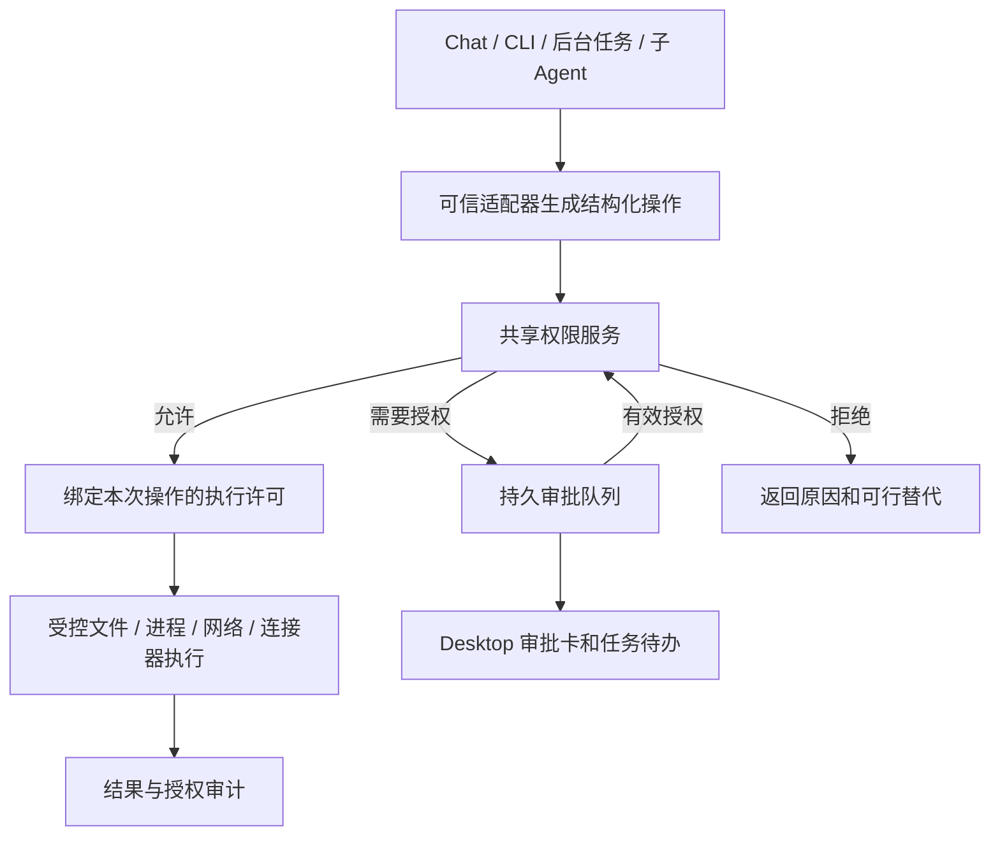

# SomniQ Studio 权限系统开发计划

日期：2026-10-08。状态：设计提案，尚未实施。范围：Desktop 优先，共享 Rust 内核同时服务 CLI；首个完整验收平台为 Windows。

本轮项目目标：依据现有代码和 Kimi Code、Claude Code、Codex 的官方机制，确定可执行、可恢复、可审计的权限架构，并拆出有验收条件的开发阶段。成功标准是明确默认行为、执行边界、审批生命周期、旧配置迁移、模块落点及交付顺序。

已读取当前项目目标：科研绘图仍处于 active，存在未验证项目。本提案单独记录权限建设目标，不把已有目标或工作区修改视为已完成。另检查了本地会话索引；当前索引中的有限历史未检出可直接复用的权限系统讨论。

**建议采用：结构化授权规则 + 执行前统一检查 + 操作系统隔离 + 持久审批。默认让研究在授权范围内连续推进，越界时申请具体能力。AI 自动审批在基础边界成熟后接入。**

## 1. 竞品参考与取舍

以下是查阅日期时官方文档描述的行为，客户端、版本和企业配置可能不同。右列是 SomniQ 的设计判断，不代表这些产品的内部实现。

| 参考对象 | 已核实的机制 | SomniQ 的取舍 |
| --- | --- | --- |
| Codex | 沙箱规定文件和网络边界，审批策略决定何时请求授权；命令及其子进程受平台隔离约束。[官方沙箱文档](https://learn.chatgpt.com/docs/sandboxing) | 将资源范围与审批方式建模为独立维度；减少范围内常规操作的打断 |
| Codex Auto-review | 独立审批 Reviewer 评估符合条件的请求，主 Agent 仍在原沙箱中工作；它不提供确定性的安全保证。[官方 Auto-review 文档](https://learn.chatgpt.com/docs/sandboxing/auto-review) | 后续提供可选的权限审批 Agent，不能代替隔离，也不能代替研究质量 Reviewer |
| Claude Code | 工具及参数规则支持 allow / ask / deny；deny 优先于 ask，ask 优先于 allow；项目授予能力的配置需要工作区信任。[官方权限规则](https://code.claude.com/docs/en/permissions) | 采用明确的拒绝优先级、规则来源展示和项目配置的信任登记 |
| Claude Code 模式 | `dontAsk` 只运行已预授权操作，原本要询问的操作被拒绝；`auto` 使用另一模型做评估。[官方权限模式](https://code.claude.com/docs/en/permission-modes) | “不询问”单独表示后台处理策略，不能作为“全部允许”的别名 |
| Kimi Code Desktop | 审批卡可展示命令、文件改动或计划；Composer 提供 Always Ask、Ask When Needed、Never Ask。[官方桌面交互](https://www.kimi.com/code/docs/en/kimi-code-desktop/task-execution-and-review.html) | 简化日常界面，审批展示具体作用范围，提供可理解的预设 |
| Kimi Code CLI | 支持会话批准及持久规则；规则按顺序匹配，提供 allow / deny / ask 和 scope / reason。[交互文档](https://www.kimi.com/code/docs/en/kimi-code-cli/guides/interaction)、[配置文档](https://www.kimi.com/code/docs/en/kimi-code-cli/configuration/config-files.html) | 保留作用域、说明和会话复用；SomniQ 使用拒绝优先语义，避免规则排列改变拒绝效果 |

不复制各产品的模式名字或整套配置语言。SomniQ 需要额外覆盖文献服务、模型调用、研究材料外发、实验预算、后台恢复和独立研究审查。

## 2. 当前代码的基础和缺口

以下结论来自当前工作树的静态检查，未进行完整安全审计或攻击验证。

| 已有实现 | 观察与影响 | 开发落点 |
| --- | --- | --- |
| 按工具登记权限，执行前调用 `authorize` | `PermissionMode` 同时容纳 ReadOnly、WorkspaceWrite、DangerFullAccess、Prompt、Allow；主要依赖等级比较，缺少目标路径、主机、动作和有效期条件。Prompt 目前对每个工具都询问 | [permissions.rs](F:/Agent/Aris/crates/runtime/src/permissions.rs:4)、[conversation.rs](F:/Agent/Aris/crates/runtime/src/conversation.rs:1531) |
| Desktop 权限选择器及共享策略组装 | 未配置时默认 DangerFullAccess；配置加载失败经 `.ok()` 后也可进入这个默认。会话模式存于内存 HashMap | [engine.rs](F:/Agent/Aris/desktop/src-tauri/src/engine.rs:4083)、[共享 Chat 策略](F:/Agent/Aris/crates/chat/src/lib.rs:2163) |
| 工具审批卡及审批事件 | 有请求、响应和解决事件；当前审批依赖内存 channel，响应仅为布尔值，没有单次/会话/项目范围和可恢复的执行许可 | [Desktop 审批](F:/Agent/Aris/desktop/src-tauri/src/engine.rs:2698)、[审批卡](F:/Agent/Aris/desktop/src/chat/ChatMessage.tsx:740) |
| 文件路径规范化、工作区和只读根检查 | 可以复用，但边界依赖执行上下文提供根目录；它不约束任意脚本或外部进程 | [file_ops.rs](F:/Agent/Aris/crates/runtime/src/file_ops.rs:4304)、[execution_context.rs](F:/Agent/Aris/crates/runtime/src/execution_context.rs:15) |
| SandboxConfig / SandboxStatus | `filesystem_active` 明确为 false；namespace / network 实现依赖 Linux unshare。Windows shell 当前直接以宿主权限启动。strict_mode 默认为 false，部分沙箱配置允许工具参数覆盖 | [sandbox.rs](F:/Agent/Aris/crates/runtime/src/sandbox.rs:205)、[bash.rs](F:/Agent/Aris/crates/runtime/src/bash.rs:525) |
| MCP 动态发现及多种执行工具 | MCP 工具统一要求 DangerFullAccess；REPL、PowerShell、LaTeX 等有独立进程路径，不能只接入 bash 后宣称覆盖全部执行 | [MCP 工具登记](F:/Agent/Aris/crates/chat/src/lib.rs:2128)、[REPL](F:/Agent/Aris/crates/tools/src/lib.rs:5161) |
| 后台 worktree 和 AwaitingInput | 工作树审批器直接拒绝 DangerFullAccess；已有 AwaitingInput，但 pending action 目前只有 Question。可以扩展授权等待，无需新造任务状态系统 | [worktree 审批器](F:/Agent/Aris/desktop/src-tauri/src/work_task/permission.rs:1)、[任务模型](F:/Agent/Aris/desktop/src-tauri/src/work_task/model.rs:167) |
| 文件变更账本及受管子进程 | 可关联授权与文件版本，并复用停止进程树能力；Windows Job Object 管生命周期，不单独提供文件和网络隔离 | [change_ledger.rs](F:/Agent/Aris/crates/runtime/src/change_ledger.rs:179)、[managed_job.rs](F:/Agent/Aris/crates/runtime/src/managed_job.rs:1) |

优先解决的不是新增几个开关，而是默认自动放行、资源级规则缺失、宿主进程边界不完整，以及审批不能持久恢复。worktree 是版本和成果隔离，不能当成操作系统安全边界。

现有 `/permissions dontAsk` 会映射到 DangerFullAccess，与 Claude Code 的同名含义不同。迁移必须识别配置版本和来源，不能根据相同名称直接转换权限。

## 3. 用户看到的权限预设

预设只是多项底层策略的组合；计划工作流、是否有人在线、是否使用自动审批，内部保持独立。

| 预设 | 自动执行范围 | 边界外的行为 |
| --- | --- | --- |
| 只读规划 | 读取已授予目录，使用已授权的检索能力；仅宿主可写会话日志和明确的计划产物 | 修改研究文件、启动不受限脚本、扩大读取范围，需要切换预设或具体授权 |
| 项目内自主，推荐默认 | 在可信项目内读写、生成本地产物；在有效沙箱中运行本地测试和分析；使用事先授予的研究服务 | 精确请求新增目录、网络、外部副作用或预算，不升级整个会话为全访问 |
| 受限无人值守 | 按任务授权清单运行，包含允许的目录、服务、输出范围、执行时间和预算 | 保存待授权动作与进度，进入 AwaitingInput；用户回来后可恢复，不永久占用模型请求或审批线程 |
| 完全访问，高级入口 | 用户主动选择的较宽主机访问范围 | 清楚展示实际能力；仍遵守有效的显式拒绝及管理限制；不自动获得管理员权限，也不默认恢复到后台任务 |

新项目首次使用先建立信任：允许浏览必要的项目内容；运行仓库脚本、启用项目 MCP / hooks、采用项目授予能力的配置之前显示范围摘要。可信项目内的常规任务不重复确认。

“完全访问”是否在首版开放为一个产品决策；首版核心能力与此入口无依赖。建议先保留旧模式的可识别迁移入口，不将其作为新项目默认。

## 4. 共享 Rust 内核设计

统一入口应覆盖 Chat、CLI、后台任务、子 Agent 及原生功能触发的代理操作。前端展示和提交决定，后端判断请求是否仍有效。沿用现有 `crates/runtime`、`crates/chat`、`crates/tools` 分工。

建议的数据模型：

| 对象 | 关键内容 |
| --- | --- |
| `PermissionContext` | project / session / task / run_seq / actor / device，角色、信任版本、策略 revision；基于现有不可变 ProjectExecutionContext 传播 |
| `ActionIntent` | 工具规范名、实际动作、规范化资源、完整参数摘要、执行位置、副作用、数据流向；由可信工具适配器产生 |
| `PermissionProfile` | 可读/可写根、保护路径、网络范围、连接器范围、审批行为、隔离要求、预算约束 |
| `PermissionRule` | 资源与动作匹配、allow / ask / deny、来源、范围、有效期、解释；不执行任意用户脚本作为规则表达式 |
| `ApprovalRequest` | 请求 ID、上下文、操作 digest、策略 revision、可读预览、失效条件；全文可展开，不只保存截断后的卡片文案 |
| `PermissionGrant` | 授予主体、作用域、资源条件、创建者、到期、撤销状态；单次批准与可复用授权分开 |
| `ExecutionPermit` | 后端签发/保存的不透明短期许可，绑定本次动作和上下文；执行器消费，模型和前端不能自行构造 |
| `PermissionAuditEvent` | 谁依据哪条规则、批准什么、何时执行及其结果；关联 tool_use_id、文件账本、任务和用量记录 |

`ApprovalBehavior` 表示 `on_request` 或 `never`；`ApprovalReviewer` 表示 human 或后续 policy_agent；`InteractionMode` 表示 interactive 或 background。`never` 表示不得交互升级，未授权动作返回拒绝或任务待处理状态。

资源能力至少区分：文件读取/写入/删除，进程执行，网络检索/下载/上传，连接器读取/外部写入，凭据使用，依赖安装，系统设置，任务委派，以及可计费请求。一次工具调用可包含多种能力，例如 LiteratureSearch 同时包含检索、额度消耗和本地文献库写入。

## 5. 决策顺序与授权范围

建议固定以下顺序，并返回机器可读原因与人能理解的解释：

1. 验证调用者、工具登记、参数、资源路径、项目和运行身份；未知或解析失败的操作不得自动允许。
2. 求管理约束、父任务授权、角色、资源能力的交集；检查保护目标和显式 deny。任何下层 allow 均不能覆盖有效 deny。
3. 检查工作区信任、实际隔离能力、预算和策略 revision。缺少必要边界时返回 RequireIsolation / Unavailable，不能自动降级为宿主执行。
4. 在可授权上限内，匹配 ask 条件、用户已有授权和 allow 规则；显式 ask 每次需要本次决定，宽泛会话 allow 不抵消它。
5. 无匹配规则时使用预设；新范围由人类批准，或在后续启用的自动审批范围内评估。批准后重新检查前四项并签发许可。

一次批准满足该请求的 ask 条件，但不能解除 deny。用户要修改拒绝规则，应通过权限设置明确修改，而不是在执行卡上把拒绝变成允许。

授权复用提供四个范围：仅本次、当前会话、当前任务、当前项目。全局长期授权放在设置页；普通审批卡不默认提供“永远允许所有同类工具”。每个范围都保留目标条件，例如只读某个数据目录，或只允许某个连接器读取指定资源。

有效策略来自产品内置约束、可选管理配置、用户本机设置、已信任的项目提案以及会话/任务授权。采用约束交集与拒绝优先；设置默认值的覆盖顺序另外明确，不能用“后面的 JSON 覆盖前面”合并权限。

仓库里的权限文件是可分享的提案。实际信任记录、授权和审计放在代理不可写的宿主存储，关联项目真实路径及配置 digest。项目文件、AGENTS.md、Skill、网页、论文和工具输出均不能自行授予权限。

## 6. 默认操作矩阵

下表是“项目内自主”在项目已信任、相应能力已实现时的目标行为。

| 操作 | 默认结果 | 关键限制 |
| --- | --- | --- |
| 读取普通项目文件、编辑论文、生成图表 | 自动 | 已授权目录；版本检查和变更账本；保护文件另有规则 |
| 读取用户主动选择的外部 PDF / 数据集 | 按明确选择授予读取 | 默认仅该文件或所选目录，不顺带授予其父目录和写权限 |
| 沙箱内运行 Python、R、测试、LaTeX | 自动 | 已批准的代码执行能力、目录和资源限制；通用 shell 默认无网络 |
| 使用已授予的 Scopus / arXiv 等服务 | 自动 | 允许的服务和查询范围、配额；不能因此任意上传项目文件 |
| 使用已选择的 Executor / Reviewer 模型 | 按任务数据授权执行 | 明示会发送任务上下文/所选附件；配置 API Key 本身不授予整库外发权限 |
| 在项目环境安装依赖 | 需要已有明确授权，否则询问 | 限项目环境和登记源；生命周期脚本仍按代码执行处理；尽量隔离私密材料 |
| 向外部目录导出 | 首次对目标授予写入 | 覆盖已有文件保留版本/冲突检查；不扩大整个磁盘权限 |
| 删除原始数据、递归批量删除 | 具体预览和明确授权 | 范围与预计影响明确，能恢复的走隔离区/快照；普通编辑授权不涵盖原始数据删除 |
| Git push、发送邮件、上传未公开稿件、投稿、修改远程系统 | 需要这类动作的明确授权 | 目标、内容、身份、额度与有效期绑定；“完成论文”不自动包含“投稿” |
| 读取密钥、修改权限规则、系统设置或提升管理员权限 | 保护/专门授权路径 | 普通文件写权限、无人值守预设和 AI 审批均不能隐式覆盖 |

金额与调用次数分别限制。首版优先保证并发调用次数、时长和已知额度的原子预留；价格未知时显示费用未决，不承诺准确的金额硬上限。费用未决或外部调用结果未知时，不能靠自动重试消除状态。

## 7. 执行隔离与入口覆盖

**文件。** 把现有路径检查升级为显式 FileAccessPolicy，根目录缺失时不退化为全盘访问。覆盖不存在目标的父目录、符号链接、Windows junction/reparse point、UNC、大小写、驱动器相对路径及替代数据流。执行时重新校验目标；涉及竞态时使用平台句柄/隔离保证，不能把字符串 canonicalize 当成完整保证。网络路径在解析前先检查，避免路径探测本身访问远端。

**进程。** 新增统一的受控启动接口，复用 process_registry 和 managed_job。bash、PowerShell、REPL、Notebook、LaTeX、脚本、代理子进程都携带同一上下文与执行许可。子进程、后台服务及复用进程绑定策略 revision；撤销后停止或重建受影响进程，不能继续使用旧连接和旧授权。

**命令判断。** 结构化 executable / argv / cwd 优先；shell 使用对应语言的解析器处理可理解的表达式。复合命令按最严格结果处理，无法静态理解的脚本按“任意代码执行”要求隔离或明确授权。`python`、`powershell`、`npm test` 这样的前缀本身不能证明操作安全；测试脚本也能读取凭据或联网。命令规则用来减少审批，实际影响由执行边界限制。Codex 对可解析命令链与复杂脚本区别处理，值得参考，但无需照搬其 Starlark 配置语言。[官方命令规则](https://learn.chatgpt.com/docs/agent-configuration/rules)

**网络。** 区分模型服务的宿主请求与工具进程的网络访问。默认通用脚本无网络；搜索、下载、上传、远程写入通过受控适配器执行。检查 scheme / host / port、跳转后的目标、私网和本机地址，避免只校验初始 URL。域名允许不等于上传授权，也不能识别所有语义上的数据泄漏。凭据尽量由宿主连接器按目标注入，不把全部宿主环境变量传给子进程。

**MCP 与 hooks。** server 启动和工具调用分别授权；发现工具之前可能已执行 server 进程，因此信任检查必须提前。绑定 server 身份、配置摘要和工具 schema 版本；更新后使旧宽泛授权失效。`readOnlyHint` 等标记作为提示信息，不能单独产生信任。首版仅对审核过的适配器自动放行，未知工具在无人值守中进入待授权或拒绝。项目 hooks 默认未信任，不能因为一次工具获准就自动运行任意项目脚本。

**原生功能与远程控制。** 盘点所有会执行代理输入的 Tauri 命令和功能入口，包括图表、文档、笔记本、浏览器及邮件适配器，防止绕过聊天层。人类直接点击确定的保存/导出行为可作为该动作的授权凭据，后端仍校验范围；代理不能伪造点击来源。远程设备配对权限与当前任务策略取交集，配对不授予后台自动越权能力。用户手动终端及第三方编辑器扩展的权限边界应明确展示。

平台策略：

| 平台 | 实施方向 | 发布要求 |
| --- | --- | --- |
| Windows，首版重点 | 先做能力验证，比较可复用的原生隔离后端、受限身份/ACL/网络限制的可维护性；Job Object 继续负责进程生命周期 | 实测读/写拒绝、网络拒绝、子进程继承、PowerShell/Python/Git/LaTeX 兼容；不存在静默的无隔离回退 |
| Linux / WSL2 | 基于成熟 OS 隔离组件实现真实挂载与网络策略，替换仅有 unshare 启动参数的不足 | WSL 的宿主互操作和宿主挂载也要被约束；WSL 或容器的存在本身不是验收证据 |
| macOS | 独立平台适配器及能力探针，参考成熟系统级隔离实践 | 按相同契约验收；未验证平台不显示“已隔离” |

当前 Codex Windows 文档还描述了依赖设备能力的 MXC 和经典隔离回退；不能仅凭 Windows 版本决定可用性。P0 应据实际开发/目标设备验证选型，不承诺直接复用某一后端。[Codex Windows 沙箱](https://learn.chatgpt.com/docs/windows/windows-sandbox)

Claude Code 当前官方说明其 Bash 沙箱支持 macOS、Linux 和 WSL2，原生 Windows 命令不在该沙箱中；文件工具、MCP 和 hooks 也不被这个 Bash 沙箱统一覆盖。这说明我们必须逐入口验收。[Claude Code 沙箱范围](https://code.claude.com/docs/en/sandboxing)

## 8. 可恢复审批与无人值守

审批需要成为持久状态，流程为 `pending -> approved / denied / expired / cancelled`；获准的执行另记录 `prepared -> executing -> succeeded / failed / outcome_unknown`。审批成功不等于操作执行成功。

一次授权绑定 project_id、session_id、task_id/run_seq、tool_use_id、参数 digest、目标资源、有效策略 revision 和有效期。用户点批准时，后端验证调用来源与请求身份，并用事务更新；重复点击只能消费一次许可。审批期间输入、文件关键版本、连接器身份或策略变化，使旧批准失效并重新评估。

持久存储使用宿主管理的 SQLite 事务，前端审批卡和任务页作为投影；事件与现有会话记录关联。记录批准范围、规则来源、拒绝原因及执行结果，敏感参数脱敏，必要的原始预览独立受控保存。保护存储不被代理改写，不将本地日志描述为能抵抗宿主管理员篡改的证明。

重启恢复 pending 请求时重新评估策略；一次性批准不跨运行盲目重放。外部副作用使用服务支持的幂等键；不支持幂等且结果未知时先核对外部状态，禁止自动重复发送、提交或计费。

后台任务扩展现有 `WorkTaskPendingAction`，新增 Permission 变体，沿用 `AwaitingInput` 和 `run_seq`。遇到 ask 时保存动作与会话检查点后结束本轮，任务显示“待授权”。响应后恢复同一任务，重验再执行。其他独立任务可以继续；不假设当前单线任务能自动跳过任意有依赖的步骤。

连续拒绝按动作、目标和语义类别做去重/限流，返回结构化原因，避免 Agent 换一个工具再次执行同一被拒绝动作。拒绝、审批超时、隔离不可用、预算不足分别记录。

## 9. Executor、Reviewer 与任务授权

保留 Executor -> 独立研究 Reviewer -> 修订的产品流程。

- Executor 在任务能力范围内收集文献、运行分析和修改成果。
- 研究 Reviewer 默认读取冻结证据和成果，写入指定评审记录；不修改被审对象、不授予 Executor 权限。确需复现实验时，创建受约束的验证任务。
- 子 Agent 得到父任务能力的子集；新的进程、会话或设备不会扩大范围。身份与授权随不可变执行上下文传播，跨线程不能依赖当前前台项目。
- 后续权限审批 Agent 只评估一个具体动作，使用独立提示和审计上下文；不能改规则、执行被审动作或覆盖明确拒绝。失联、超时、输出无效时进入人工/待授权，不自动放行。

无人值守任务启动时展示一次“本任务允许”：输入目录、输出目录、可运行工具、外部服务、数据用途、调用/时间预算、是否允许删除或外发。授权后常规工作连续执行；新目标、新材料外发和预算升级再申请。

任务授权由真实用户操作或受信的设置流程形成。用户的研究需求可以帮助提出授权清单，但模型对“用户应该同意”的推断不能直接生成授权记录。

## 10. Desktop 交互

Composer 保留一个权限入口，点击展示当前预设、范围和真实隔离状态。常规界面使用“读取这个文件”“允许本项目访问此服务”等语言，不要求用户理解内部枚举。

审批卡回答五件事：要做什么、为什么触发、会影响哪些文件/服务、会发送哪些数据、这次批准能持续多久。涉及修改提供 diff，涉及外发提供目标和内容摘要，完整参数可展开。

按钮按动作提供“允许一次”“本会话允许此范围”“本任务允许此范围”“拒绝并说明”；持久项目规则通过范围预览后保存。规则页支持查看来源、到期、撤销及“为什么允许/拒绝”的解释。

复用聊天内审批卡，并增加跨会话的待授权列表。后台待授权能在任务卡和通知入口找到，切换项目或窗口后不丢失；旧卡片反映真实状态，不能因页面重开重新批准已执行的动作。中英文文案、键盘操作和窄屏布局一起验收。

## 11. 分阶段开发与验收

以下为有效开发工作量的粗估，包含阶段内测试；以一名熟悉现有代码的主力开发为基准，不是交付承诺。Windows 选型应在 P0 后重估。

| 阶段 | 工作量 | 交付内容 | 完成门槛 |
| --- | --- | --- | --- |
| P0 边界盘点与选型 | 2 人日 | 所有副作用入口清单、权限决策表、旧配置样本、Windows 隔离探针、MVP 契约 | 确认每条执行路径的控制位置和平台能力；不把进程管理当隔离 |
| P1 共享权限内核 | 4–5 人日 | ActionIntent / Policy / Grant / Permit；纯规则决策；FileAccessPolicy；可信配置加载和旧模式适配 | 各入口同输入同决策；未知输入和配置错误不放行；父子任务不能扩权 |
| P2 持久审批与 Desktop | 4–5 人日 | SQLite 审批/授权/审计，范围审批卡，权限列表及撤销，恢复和去重 | 重启、重复点击、迟到响应、切项目及规则修改测试通过；单次授权只消费一次 |
| P3 Windows 执行边界 | 8–12 人日 | 统一进程启动、文件/网络隔离、受控网络与连接器、MCP/hook 启动信任、能力状态 | 正向工作负载和越界拒绝在真实 Windows 通过；不支持则明确停用对应自动执行 |
| P4 无人值守研究闭环 | 4–5 人日 | 任务授权清单、Permission 待处理动作、预算预留、角色继承、研究服务接入 | 文献检索到本地产物在授权范围内完成；需要外发/越界时可暂停并可靠恢复 |
| P5 迁移与发布验证 | 3–5 人日 | 模式迁移、规则解释、回归、安装版 WebView2 验收、发布开关及回退说明 | 新安装与升级路径均通过，权限缩紧即时生效；恢复不重放外部副作用 |

完整 Windows MVP 约 25–34 人日，即单主力约 5–7 个有效开发周。AI 自动审批和 Linux/macOS 完整适配另立里程碑，不塞进首版估算。

依赖顺序：P0 -> P1 -> P2；P3 基于 P0 的选型与 P1 的执行许可接口；P4 依赖 P2/P3；P5 贯穿各阶段并最终验收。前后端可按稳定接口分工，但不能把依赖阶段当成可以完全并行来压缩工期。

两个可交付节点：

- 第一节点，P0–P2：新策略模型与可恢复审批可用。尚无有效沙箱的通用进程继续具体审批或拒绝，不开放“安全无人值守”的产品承诺。
- 第二节点，P3–P5：Windows 上授权内研究可连续推进，外部副作用可审查，后台任务遇到边界可持久等待并恢复。

建议按以下模块拆 PR，避免继续扩大 engine.rs 和 tools/lib.rs：

| 模块 | 变更方向 |
| --- | --- |
| `crates/runtime/src/permissions.rs` 及新增 `permissions/` 子模块 | 保留对外入口，新增类型、规则、授权、存储、审计及兼容适配 |
| `crates/runtime/src/execution_context.rs`、`file_ops.rs` | 传播主体和策略引用；文件执行前取得具体许可 |
| `crates/runtime/src/sandbox.rs` 及平台子模块、`process_registry.rs` | 隔离适配与真实能力探针；统一进程生命周期和授权失效处理 |
| `crates/runtime/src/conversation.rs`、`crates/chat/src/lib.rs` | 委托共享权限服务；工具可见性与可执行性继续分开 |
| `crates/tools/src/lib.rs` 及各工具模块 | 可信动作描述与执行适配；逐步消除直接副作用旁路 |
| `desktop/src-tauri/src/engine.rs` 及新增权限命令模块 | 从聊天引擎提取审批适配，提供查询/决定/撤销接口 |
| `desktop/src-tauri/src/work_task/` | 扩展 Permission 待处理动作、任务授权、恢复与 run_seq 校验 |
| `desktop/src/chat/` 及权限设置组件 | 范围卡片、解释、有效隔离状态和待授权入口 |

## 12. 迁移与回退规则

1. 引入 schemaVersion，区分历史默认、用户显式全访问和新配置。新建可信项目默认项目内自主；旧配置不静默扩权。
2. 历史 ReadOnly / WorkspaceWrite 映射为兼容预设。`Prompt` 先保留旧“逐工具确认”的语义，用户可主动切换到推荐预设，不在升级中偷偷减少询问。
3. 历史 DangerFullAccess / Allow / dontAsk 显示真实语义和来源，提供一次迁移说明；不要将它们视作新的无人值守授权清单。
4. 配置损坏、来源未信任、规则不支持、隔离初始化失败时维持已知安全限制或拒绝运行相关动作，显示可修复错误；不回落至 DangerFullAccess。
5. 先在开发验证中对比新旧决策，记录差异；权限扩张必须由用户确认，不通过“兼容开关”静默允许。关闭新功能也不能解除保护限制。
6. 恢复会话重新校验当前策略、设备和项目身份；可复用授权按有效期恢复，过期/撤销/一次性批准不恢复。
7. 先只回退 UI 或非安全功能；安全内核版本与持久状态兼容必须检查，旧客户端不能误读新授权为全访问。

## 13. 验收场景和发布门槛

必须验证行为边界，而不只测试枚举映射：

| 场景 | 预期结果 |
| --- | --- |
| 改论文 -> 本地分析 -> 生成图表 -> 编译 PDF -> 独立 Reviewer | 在预授权范围内连续完成；每步有来源和结果记录 |
| 外部数据只读授权 | 能读取指定数据，不能修改或删除，也不能读取相邻无关目录 |
| 用 REPL / PowerShell / LaTeX 子进程尝试绕过文件限制 | 执行层拒绝，结果与直接文件工具一致 |
| 路径穿越、junction、符号链接替换、UNC、大小写变化 | 规范化和执行期边界共同生效，不因字符串形式变化扩权 |
| 已允许命令附带重定向、命令替换、管道或脚本参数 | 对完整调用重新判断，宽泛前缀不能放行未授权副作用 |
| 测试/安装脚本尝试读取凭据并直连网络 | 保护读取和网络边界生效；私密材料不随依赖安装默认暴露 |
| 搜索服务返回跳转到私网/其他域名 | 对实际目标重验；域名匹配没有后缀或跳转绕过 |
| 项目偷偷新增 MCP / hook / 允许规则 | 启动或加载授权前被信任检查挡住 |
| 用户批准时项目已切换、参数已改、策略已撤销 | 旧请求失效，不在错误上下文执行 |
| 同一请求多窗口/远端重复批准 | 最多发放并消费一次许可，后续显示已处理 |
| 批准后进程崩溃，外部结果未知 | 先核对状态，不重发邮件、上传、提交或计费请求 |
| 后台任务等待授权时重启 | 检查点和待处理动作保留，不占用悬挂模型轮次 |
| 子 Agent / Reviewer / 远程设备请求更大权限 | 父任务和角色的上限仍生效，不能自行批准 |
| 并发计费任务和运行中撤销 | 预算预留原子化，后续调用受限，受影响的存量进程/连接被处理 |
| 沙箱不可用或配置无法解析 | 可见地拒绝对应动作，不显示“已隔离”，不静默放行 |

Rust 先运行改变模块的针对性测试，再运行跨 crate 的 `cargo test --workspace`。Desktop 原生后端另用 `cargo test --manifest-path desktop/src-tauri/Cargo.toml` 的相关过滤器验证；前端运行相关 Vitest、`npm run typecheck` 和 `npm run build`。最后验收 Windows 安装版与 WebView2、实际子进程以及可控本地网络服务，不能用浏览器 mock 代替系统隔离测试。

计费模型、真实邮件和投稿服务不是自动回归前提：用受控模拟端点验证审批和幂等，真实服务验证单独记录结果。实现后应记录实际通过/失败/未测证据，不把本计划中的命令列举视为测试通过。

上线指标先建立基线：授权范围内任务的完成率、每任务审批次数、重复请求比例、后台恢复成功率、拒绝后的重复尝试次数、权限决策延迟与未知外部结果数量。固定的越权回归集必须全部拒绝成功；不承诺能够证明不存在所有未来绕过。

首个开发动作建议为 P0：完成副作用入口矩阵和 Windows 隔离原型，然后冻结 P1 的 ActionIntent / ExecutionPermit 接口。这样后续 UI、后台恢复和平台执行可以围绕同一个权限事实源推进。
