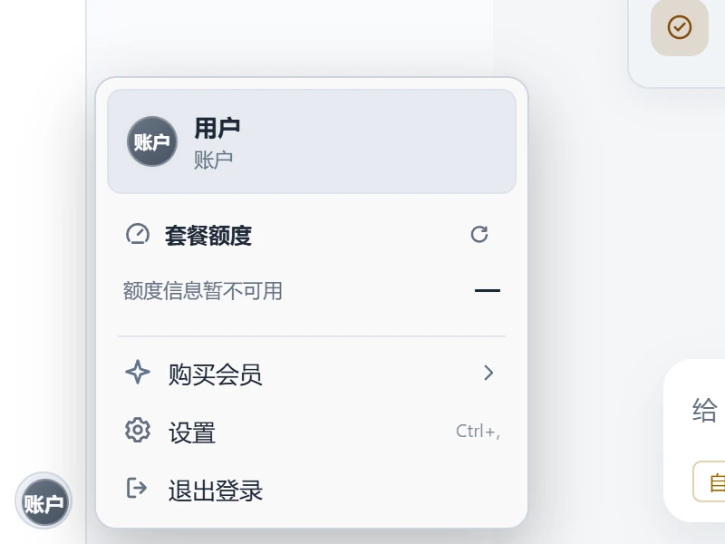
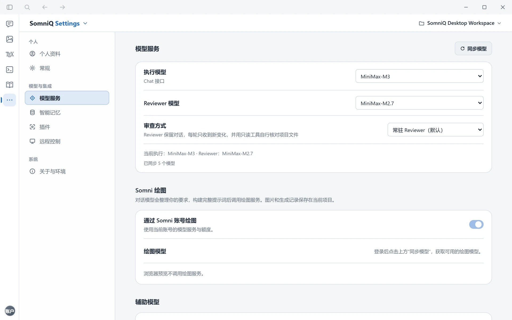

# 账号、会员与模型

> 适用版本：SomniQ Studio v0.4.86 · [返回目录](README.md)

SomniQ Studio 的模型调用全部通过 **SomniQ 账号** 完成：登录后，账号下可用的模型会自动同步到应用里，调用消耗账号额度。当前版本 **不支持** 在应用里填写 OpenAI、Anthropic 等第三方 API Key。

## 1. 账户菜单

点击左侧图标栏底部的 **头像**（LaTeX、文献等没有图标栏的页面在页面顶部）打开账户菜单，可以看到：

- 头像、名称和会员档位（Free / Go / Plus / Pro，免费版显示为 Free）。
- **套餐额度**：**剩余额度**（以 `$x.xx` 显示）和“剩余 N%”进度条。有订阅套餐时显示订阅余额，否则显示钱包余额。点击刷新图标可手动刷新；刷新失败时会显示上次的额度。
- 菜单项：
  - **购买会员**（免费用户）或 **会员升级**（已付费用户）：打开购买面板。
  - **设置**（Ctrl + ,）
  - **退出登录**

## 2. 个人资料与用量

打开 **设置 → 个人资料**：

- **头像**：**选择头像** / **更换头像** / **移除**。支持 PNG、JPG、WebP，不超过 10 MB，只保存在本机。
- **账户概览**：**购买会员** / **会员升级**、**刷新**、**退出登录**。
- **额度卡片**：
  - **账户总额度**：当前账号已用额度、账户余额。
  - **订阅套餐**：订阅已用、订阅余额。
- **活动统计**：累计令牌数、单日峰值令牌数、最长任务时长、当前连续天数、最长连续天数；**令牌活动** 图表（每日 / 每周 / 累计）；最常用的技能；模型使用分布。
- **调用明细**：按时间列出每次调用的模型、令牌数、消耗额度，每页 12 条。

## 3. 会员档位

| 档位 | 外部文献检索（含系统检索、综述工作流） | 联网搜索 |
| --- | --- | --- |
| 免费版 | 不可用，可使用本地文献库 | 不可用 |
| Go | 可用 | 可用 |
| Plus | 可用 | 可用 |
| Pro（最高档位） | 可用 | 可用 |

各档位每期包含的模型积分、可用的模型和价格以购买面板和 **设置 → 模型服务** 中同步到的结果为准（价格由服务器下发，学生认证用户可能看到学生优惠价）。

几条与档位相关的规则：

- **外部文献检索需要 Go 及以上**。免费版检索外部数据库时会提示“外部文献检索（含系统检索与综述工作流）需要 Go 及以上会员，当前是免费版；免费版可使用本地文献库。”
- **联网搜索**（DeepSeek 搜索）在 Go、Plus、Pro 档位可用。每次返回结果的成功搜索消耗 1 积分（与一次返回多少条结果无关），优先使用当月包含的额度。
- **Scopus** 属于外部文献检索，同样需要 Go 及以上会员；登录后通过 SomniQ 学校通道检索，校外也可使用。**OpenAlex** 已内置，无需 API 密钥。

## 4. 购买或升级会员

1. 从账户菜单点击 **购买会员** / **会员升级**，或在 **设置 → 个人资料 → 账户概览** 中点击同名按钮。面板标题为 **购买月度会员**（已付费用户为 **会员升级**），注明“单次购买 · 不自动续费”。
2. **选择套餐**：面板显示“当前套餐”以及 Go / Plus / Pro 卡片，每张卡片标明价格（¥ / 1 个月）和“本期模型积分”。默认选中比当前高一档的套餐；Pro 用户默认选中 Pro，再次购买会从付款时起算新的月度周期。
3. **核对订单**：确认购买账号、支付方式（支付宝）和本次实付金额。
4. 勾选 **我已核对套餐、金额，并同意**《用户服务协议》。
5. 点击 **确认并前往支付宝支付**。应用会在浏览器中打开支付宝电脑收银台，扫码付款。
6. 付款后回到应用，点击 **刷新账户**（应用重新获得焦点时也会自动核对）。看到会员档位更新即表示生效。

需要注意：

- 会员 **付款核验后生效一个月**，本期积分随本期到期失效。
- 已有套餐时，新购月份 **从本次付款起算**，不顺延原套餐，也不抵扣原套餐费用。
- “收银台打开”不代表付款成功，请以刷新后的账户状态为准。
- 收银台没打开或被关掉了，点击 **重新打开当前收银台**，会继续使用同一笔订单，不会重复下单。
- 如果提示“暂时无法确认订单状态”，请先刷新账户核对，避免重复购买。
- 提示“价格或权益已更新”时，点击 **重新读取价格** 后再购买。

## 5. 执行模型与审查模型

SomniQ Studio 的核心是两个角色：

- **执行模型（Executor）**：理解你的请求，调用工具检索、读写文件、运行实验、撰写内容。
- **审查模型（Reviewer）**：在执行模型完成实质性工作后，以独立身份检查方法、证据和论证，提出修订意见。审查流程见 [对话 · 独立审查](chat.md#9-独立审查)。

在 **设置 → 模型服务** 中配置：

1. 点击 **同步模型**，拉取账号下可用的模型列表（登录后会自动同步，状态栏显示“已同步 N 个模型”）。
2. **执行模型**：选择日常对话使用的模型。
3. **Reviewer 模型**：选择审查模型，或选 **关闭 Reviewer 模型**。
4. **审查方式**：
   - **常驻 Reviewer（默认）**：审查模型可以读取项目文件、核查证据。
   - **一次性审查**：审查模型不能使用工具时选择此项。

> **执行模型和审查模型必须是不同的模型。** 设置页不会阻止你选成同一个，但这样独立审查会被拒绝执行（对话中显示“独立 Reviewer 当前不可用”）。科研绘图页面会自动检测并提示更换。

**价格标识**：模型旁的倍率标识（如 `1.5×`）表示相对价格，以“deepseek-v4.1-flash 高峰 = 1×”为基准（输入与输出按 1:1 计）。其他标识包括 **免费**、**阶梯计费**、**价格未知**。按次计费的模型显示为 `0.1`，它不是倍率，表示按调用次数计费、无法与按令牌计价的模型直接比较。把鼠标悬停在标识上可以看到说明和价格更新时间。

**在对话中临时切换模型**：点击输入框下方的模型按钮，或输入 `/model`、`/reviewer`。详见 [对话](chat.md#4-模型与思考强度)。

## 6. 其他模型相关设置

同在 **设置 → 模型服务** 页：

| 设置 | 说明 |
| --- | --- |
| **Somni 绘图** | 开关“通过 Somni 账号绘图”，并选择 **绘图模型**，供科研绘图和对话中的出图使用 |
| **辅助模型 → 摘要模型** | 用于压缩长对话上下文。可选 自动 / 关闭 / 指定模型 |
| **辅助模型 → PDF 检索卡模型** | 用于从 PDF 中提取检索卡片，默认跟随执行模型 |
| **学术文献检索** | 说明 Scopus、OpenAlex 的接入方式（固定文字，不是实时检测；实时检测见 **设置 → 关于与环境 → 检索工具可用性**） |
| **网络与社区搜索 → 网络检索代理** | 访问外网需要代理时填写，例如 `http://127.0.0.1:10808` |
| **高级 → 配置文件** | 显示本地配置文件路径（只读） |

修改会自动保存；保存失败时提示“保存失败，已保留原设置。”，可点击 **重试**。

## 7. 退出登录

在账户菜单或 **设置 → 个人资料** 中点击 **退出登录**。退出不会删除本地的项目、对话和文献库。如果登录状态在后台失效（例如密码被修改），应用会自动退出并回到登录页。
