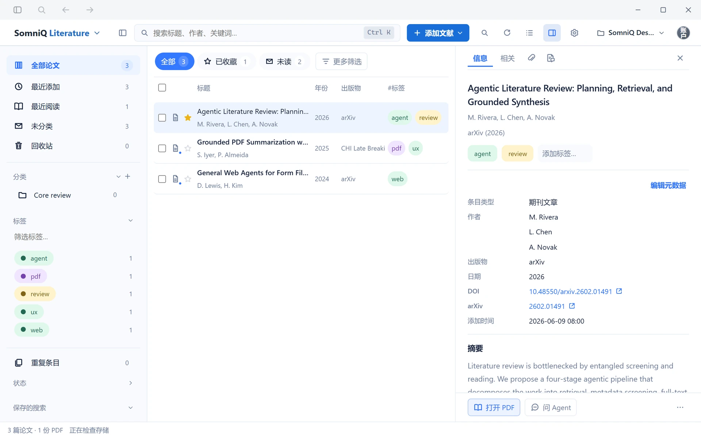
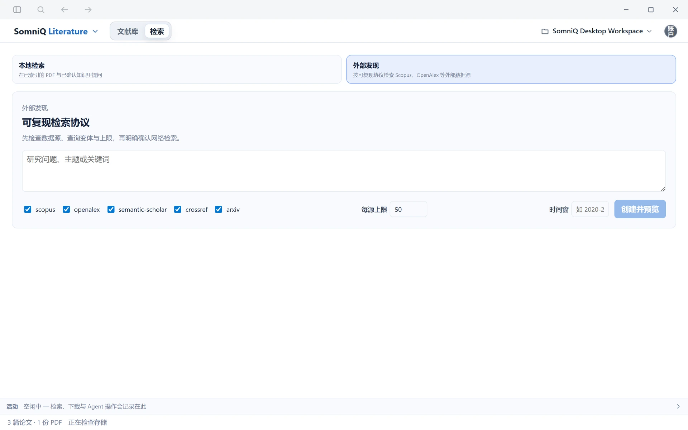

# 文献

> 适用版本：SomniQ Studio v0.4.86 · [返回目录](README.md)

**文献** 页是项目的本地文献库：导入和整理文献、阅读与标注 PDF、在全文中检索证据，以及按可复现的检索式检索外部数据库。每个项目有自己独立的文献库，保存在项目文件夹中。

页面顶部有两个入口：**文献库**（管理条目）和 **检索**（本地检索 / 外部发现）。

## 1. 添加文献

点击 **添加文献**：

| 菜单项 | 用途 |
| --- | --- |
| **导入 PDF** | 从本地 PDF 建立文献条目 |
| **导入文献库** | 导入 BibTeX（`.bib` / `.bibtex` / `.biblatex`）、RIS（`.ris`）、CSL-JSON 或 Zotero 导出的 JSON（`.json`） |
| **添加 DOI / ISBN** | 输入 DOI 或 ISBN，自动补全题录 |
| **新建条目** | 手工填写标题、条目类型和作者（多位作者用 `;` 分隔） |

- 直接把 PDF 拖进窗口，也会建立文献条目。
- 从 Zotero 迁移：在 Zotero 中导出为 **Zotero JSON**（不是实时同步），再用 **导入文献库** 导入，笔记、标注和分类会一并导入。附件仍指向 Zotero 中的原始路径，需要用 **导入附件** 把它们复制到项目中后再打开。导入结果会提示新增和合并的条目数。

## 2. 整理文献库

**左侧导航**：我的文库、全部论文、最近添加、最近阅读、未分类、已收藏、重复条目、回收站、A / B / C / D 分级、分类（支持子分类）、保存的搜索、标签。

**搜索**：顶部搜索框（Ctrl + K）按标题、作者、关键词搜索；**高级搜索** 支持 AND / OR 组合条件，并可 **保存搜索**。

**单条操作**（右键或行菜单）：打开 PDF / 获取 PDF、显示详情、**问 Agent**（带着该文献标题打开对话，运行文献调研技能）、复制引文、标为已读 / 收藏、加入候选、排除、移入回收站。

**批量操作**（勾选多条后出现）：候选、下载 PDF、复制引文；更多菜单中有排除、生成报告…、合并重复条目（恰好选中 2 条时）、删除。

**回收站**：移入回收站后可 **撤销**；在回收站中可 **恢复** 或 **永久删除**（不可恢复）。

**条目详情**（单击条目）有以下标签页：

| 标签 | 内容 |
| --- | --- |
| **信息** | 题录元数据，双击即可编辑元数据和 Citation key（须以字母开头，只能包含字母、数字和 `: _ . -`）；可选择引用样式、导入 CSL 样式、复制文中引用或参考文献 |
| **相关** | 建立与其他条目的关系：相关 / 派生自 / 评述 |
| **文件** | 添加文件、添加网页快照、添加外部链接、设为阅读 PDF、上传本地 PDF |
| **论文讲解** | 生成图文并茂的论文讲解，见第 4 节 |
| **PDF** | 阅读 PDF |

笔记和标注以子条目的形式显示在每篇文献下。

**导出题录**：支持 BibTeX、BibLaTeX、RIS、CSL-JSON、Zotero JSON。

**文献库设置**（齿轮图标）：附件命名模板（导入和下载时自动重命名）、引文复制格式。快捷键：Ctrl + Shift + C 复制参考文献条目，Ctrl + Shift + A 复制文中引用；也可以把条目直接拖进编辑器。

> Ctrl + Shift + A 默认也是全局截图快捷键，会被截图功能优先占用。需要用它复制文中引用时，请先在 **设置 → 常规 → 工作区 → 截图快捷键** 中把截图改成别的组合键。

> 文献库底部会显示数据库的健康状态，并提供 **备份数据库**。重要文献库建议定期备份。

## 3. 获取与阅读 PDF

**获取 PDF**：条目有已知的直接下载链接时，**获取 PDF** / **下载 PDF** 会直接下载；没有直链时会提示“该论文没有已知的直接 PDF 下载链接”。

**通过浏览器获取**：配置了 Playwright 插件后（见 [插件](plugins-mail-remote.md)），可以选择 **Playwright MCP 获取 PDF**，由助手在浏览器中获取合法可访问的 PDF。助手不会绕过付费墙或验证码，需要登录时会暂停并询问你。

**内置 PDF 阅读器**（双击条目打开）：

- 视图：适合整页 / 适应宽度；单页 / 双页并排 / 四页网格；方向键翻页；也可以 **外部打开**（用系统阅读器）。
- 标注：选中文字即可标记，样式有高亮 / 下划线 / 删除线，颜色有黄 / 绿 / 蓝 / 红 / 紫，可 **加备注**。点击已有标注可编辑或删除。
- 选中文字后可以 **翻译**（中文简体与英语互译，源语言可自动检测）或 **由浅入深讲解**，可选择使用的模型。结果可以复制，或 **保存到标注**。

## 4. 论文讲解

在条目详情的 **论文讲解** 标签点击 **生成论文讲解**，按“阅读原文 → 梳理主线 → 图文讲解”三步生成。

- 需要选择 **支持图像输入** 的生成模型。
- 生成结果作为“未审核草稿”保存；如果生成时没有配置审查模型，之后可以点 **补做独立审核**。
- 失败时可 **继续生成 / 重试失败内容**（每轮最多 3 次）；不需要的版本可以 **删除此版本**。

## 5. 在对话中引用文献库

在对话中询问与本地论文相关的问题时，助手会自动在已建立索引的 PDF 全文中检索证据，工具卡片显示为 **本地文献证据 · 查询内容**。

- 回答中的引用形如 `[文献 ID p.页码]`，点击后在对话右侧打开该 PDF 的对应页，并高亮引用的原文。
- 如果提示“未找到证据”，通常是还没有为文献库建立全文索引，请先按下一节建立索引。

## 6. 检索

点击顶部的 **检索**，有两种模式：

### 本地检索

在已导入的 PDF 全文和已确认的知识中检索证据。

1. **建立索引**：首次使用点击 **建立本地索引**；之后可以 **索引当前 PDF** 或 **增量更新全库**。索引在本地完成，扫描版 PDF 可包含 OCR 页面。
2. **检索卡（可选）**：**补建检索卡** / **自动生成检索卡** 可以提升检索质量。生成检索卡使用的模型在 **设置 → 模型服务 → 辅助模型 → PDF 检索卡模型** 中设置。
3. 输入问题，选择 **仅检索证据** 或 **检索并回答**。回答会注明页码，并经过独立证据审校；点击 **打开原文页** 查看原文。

隐私说明：检索并回答时，只有与问题相关的页面片段会发送给模型。

高级维护中的 **强制重建 PDF 全文索引** 只重建索引，不会修改原始 PDF。

### 外部发现

按可复现的检索协议检索外部数据源，结果进入文献库。**需要 Go 及以上会员**。

1. 输入 **研究问题、主题或关键词**。
2. 勾选数据源：Scopus、OpenAlex、Semantic Scholar、Crossref、arXiv（默认全选）。
3. 设置 **每源上限**（1–5000，默认 50）和 **时间窗**（例如 2020–2025）。
4. 点击 **创建并预览**，在 **执行预览** 中检查每个数据源实际使用的检索式。
5. 勾选“我已检查查询与范围，确认执行外部网络检索。”，点击 **确认并执行**。
6. 检索中可以 **停止检索**（已获取的结果会保留），之后用 **继续未完成的数据源** 接着检索。
7. **覆盖状态** 显示每个数据源的总数、已获取数、去重后数量，以及是否已遍历完。

各数据源的使用条件：

| 数据源 | 条件 |
| --- | --- |
| Scopus | 登录 SomniQ 账号后通过学校通道检索，校外也能用。学校通道返回题录元数据（不含摘要），使用共享的机构配额 |
| OpenAlex | 已内置，无需 API 密钥 |
| Crossref、arXiv | 无需密钥 |
| Semantic Scholar | 当前版本默认不可用：会标记为“缺少凭据”并跳过，不影响其他数据源，可以取消勾选 |

访问外网需要代理时，在 **设置 → 模型服务 → 网络与社区搜索** 中填写 **网络检索代理**。

## 7. 与 LaTeX 写作联动

在 LaTeX 页面中点击 **插入引用**，可以直接从本项目的文献库搜索并插入 `\cite{}`，参考文献会写入由 SomniQ 管理的 `somniq-references.bib`，详见 [LaTeX 写作](latex.md#4-插入文献引用)。
