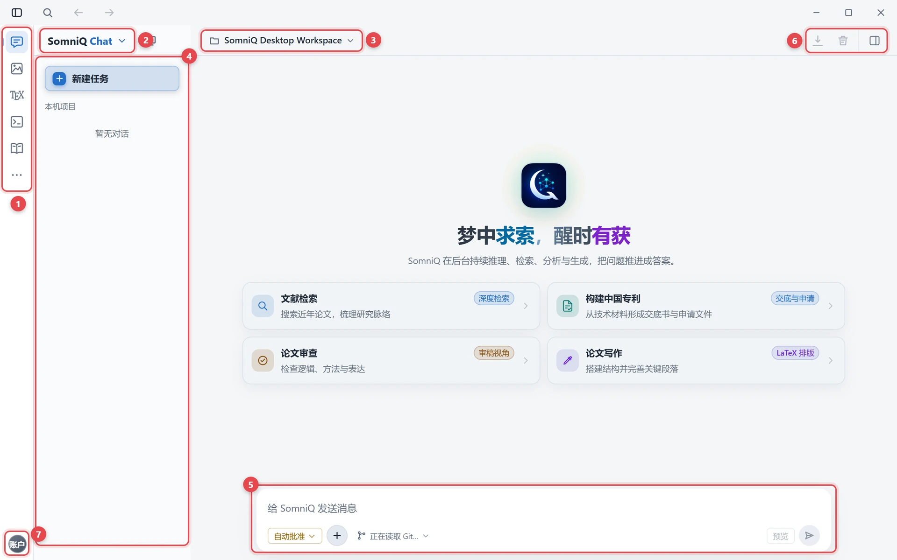

# 快速上手

> 适用版本：SomniQ Studio v0.4.86 · [返回目录](README.md)

本章带你在 10 分钟内完成登录、认识界面、添加项目，并完成第一次对话。尚未安装请先看 [安装教程](installation.md)。

## 1. 登录或注册

SomniQ Studio 使用 **SomniQ 账号** 登录，模型调用、额度和会员都跟随账号。


**登录**

1. 在登录页选择 **登录** 标签。
2. 输入 **账号**（用户名）和 **密码**，点击 **登录**。
3. 如果账号开启了两步验证，会多出 **两步验证码** 输入框，填入验证器中的验证码或备用码即可。

**注册**

1. 在登录页切换到 **注册** 标签（服务器关闭注册时不显示该标签）。
2. 填写 **账号**、**密码**（8–20 位）和 **确认密码**。
3. 如果服务器要求邮箱验证，还需要填写 **邮箱**，点击 **获取验证码**，再填入收到的 **验证码**。
4. 勾选 **我已阅读并同意服务条款与隐私政策**（如有），点击 **创建账号**。
5. 注册成功后页面会自动切回登录标签并提示“注册成功，请登录”，用刚注册的账号登录即可。

> 如果注册页显示“人机验证服务由 Cloudflare 提供支持”，说明服务器开启了人机验证，桌面端无法直接完成注册。请点击 **打开网页版注册**，在浏览器中注册后再回到应用登录。

之后每次启动，应用会先显示“正在验证登录状态...”，自动恢复上次的登录。登录凭据保存在系统的凭据管理器（Windows 凭据管理器 / macOS 钥匙串）中。

## 2. 设置工作区与新手引导

第一次登录后：

1. **设置工作区** 卡片：选择界面语言（简体中文 / English）和主题（浅色 / 深色），点击 **开始使用**。界面语言同时决定助手回复所用的语言。
2. **新手引导**：4 个步骤，依次介绍左侧图标栏、对话、项目切换器和设置。可用 **上一步** / **下一步** 浏览，或直接 **跳过**；键盘 ← / → 翻页，Esc 退出。引导只出现一次。


## 3. 认识界面



图中编号：

1. 左侧图标栏：切换工作区
2. 功能切换器：显示当前功能，点击可切换
3. 项目切换器：选择或添加项目
4. 对话侧栏：新建对话、浏览本项目的对话
5. 输入框：输入消息，左下角是权限模式和附件按钮
6. 导出当前对话、导出故障调试包、显示或隐藏右侧侧边面板
7. 账户头像：打开账户菜单

SomniQ Studio 有以下工作区：

| 工作区 | 用途 |
| --- | --- |
| [对话](chat.md) | 与 AI 协作推进研究的主入口 |
| [科研绘图](figures.md) | 生成和编辑科研插图 |
| [LaTeX](latex.md) | 编辑、编译、预览论文 |
| [代码](code.md) | 内置代码编辑器、笔记本与终端 |
| [文献](literature.md) | 文献检索、文献库与 PDF 阅读 |
| 更多功能（···） | 定时任务、待办任务、研究流程、邮箱、设置 |

**切换工作区**：

- 在对话、科研绘图、定时任务、待办任务和设置页，窗口左侧有一列 **图标栏**，点击图标切换。图标栏底部的 **头像** 是账户菜单，显示当前会员档位和剩余额度，可在这里购买或升级会员、打开设置、退出登录。
- 在 LaTeX、代码、文献等页面，左侧没有图标栏，改为页面顶部的 **功能切换器**（显示“当前功能：xx，点击切换”），账户头像也移到页面顶部。代码页的功能切换和项目切换在编辑器底部状态栏中（见 [代码与实验](code.md#2-编辑器的使用)）。

> **邮箱** 和 **研究流程** 默认隐藏。需要时到 **设置 → 常规 → 工作区** 中打开对应开关。

**页面顶部**：**项目切换器**（显示“当前项目”）。对话页顶部还有显示 / 隐藏对话侧栏、**显示项目摘要**、侧边面板、导出对话等按钮。

常用快捷键：

| 快捷键 | 作用 |
| --- | --- |
| Ctrl + ,（macOS：⌘ + ,） | 打开设置 |
| Ctrl + Shift + A（macOS：⌘ + Shift + A） | 全局区域截图，可直接发送到对话（可在设置中修改） |
| Ctrl + Alt + B（macOS：⌘ + ⌥ + B） | 在对话页显示 / 隐藏右侧侧边面板 |
| Enter / Shift + Enter | 在对话输入框中发送 / 换行 |

## 4. 添加第一个项目

SomniQ Studio 以 **项目** 为单位组织工作。一个项目就是你电脑上的一个文件夹（例如一篇论文或一个课题的目录），它的对话、文献库、编辑历史都和这个文件夹绑定。

1. 点击页面顶部的 **项目切换器**。
2. 选择 **添加本地项目…**，在弹出的系统对话框中选择一个文件夹。
3. 应用会添加并打开这个项目。之后可以随时在项目切换器中切换项目，或拖动调整项目顺序。

> 建议为每个课题单独建一个文件夹。项目之间的对话、目标和文献库互不干扰。

## 5. 第一次对话

1. 切换到 **对话**。新对话页标题为“梦中求索，醒时有获”，下方有 4 张起步卡片：**文献检索**、**构建中国专利**、**论文审查**、**论文写作**。点击卡片只会把示例填入输入框，不会直接发送，你可以先修改。
2. 在输入框中描述你的任务，按 Enter 发送。例如：

   ```text
   帮我梳理近三年用扩散模型做蛋白质设计的代表性工作，按方法分类，给出每篇的核心贡献和局限。
   ```

3. 回复过程中可以看到模型的思考过程、调用的工具（检索、读文件、运行命令等）及其结果。需要中途终止时，点击输入框右侧的 **停止回复**；之后可以点 **继续** 从中断处接着做。
4. 你的第一个实质性请求会被提炼为项目的长期目标，显示在 **项目摘要** 卡片中（对话页顶部的 **显示项目摘要** 按钮）。

几个立刻能用的技巧：

- 输入 `@` 加文件名，把项目里的文件作为上下文附上。
- 输入 `/` 调出命令与技能菜单，例如 `/research-lit` 做文献调研、`/paper-write` 起草论文。
- 直接把 PDF、图片拖进对话窗口作为附件。
- 想让另一个模型独立审查结果，打开项目摘要中的 **自动审核** 开关（详见 [对话 · 独立审查](chat.md#9-独立审查)）。

## 6. 下一步

- 了解会员档位、额度和模型选择：[账号、会员与模型](account-and-models.md)
- 深入了解对话的全部功能：[对话](chat.md)
- 开始写论文：[LaTeX 写作](latex.md)
